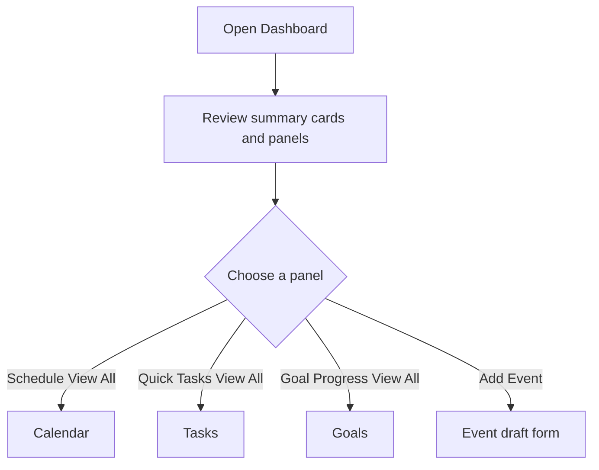
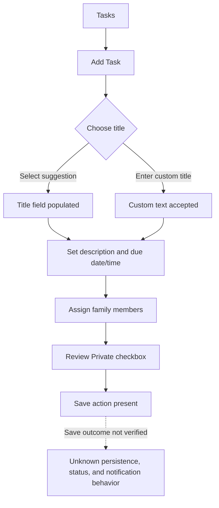
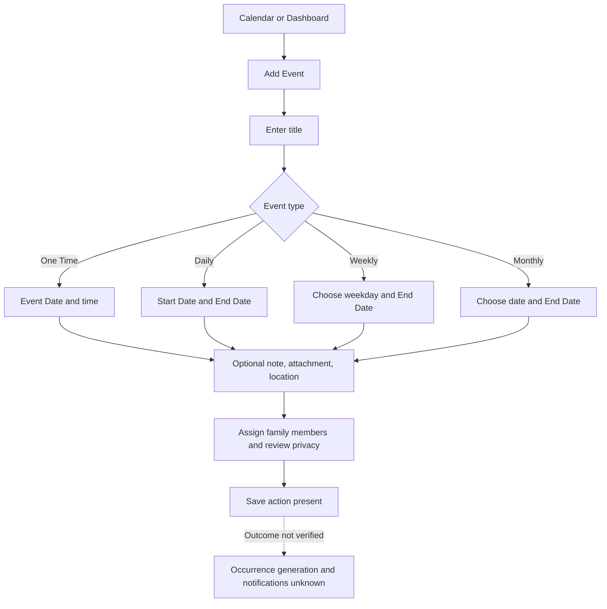
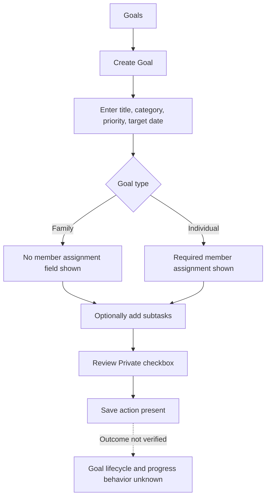
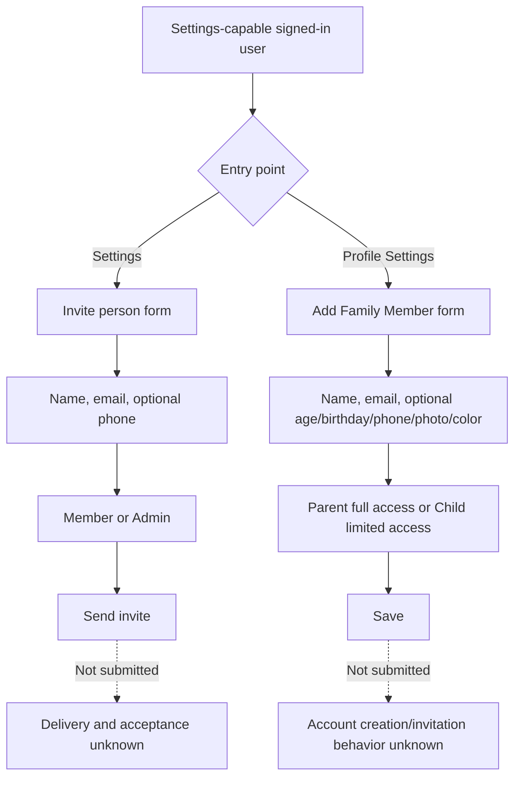

# Document 05 — User Journeys and Workflow Specification

Flows separate what was directly observed from actions whose completion would change shared account data. No invitations, messages, uploads, settings changes, or new records were submitted.

## FL-01 — Review family status and navigate to a module

- **Actor:** Signed-in family member.
- **Objective:** Review today's summary, then open a full module.
- **Preconditions:** Authenticated workspace; Dashboard available.
- **Observed success path:** Open Dashboard → review event/task/overdue/goal counts and three panels → select View All on Today's Schedule, Quick Tasks, or Goal Progress → Calendar, Tasks, or Goals opens.
- **Alternative path:** Add Event from Dashboard opens the event draft form.
- **Outputs:** No data created or changed.
- **Failure/edge cases:** Populated values and navigation under a different role are unverified.
- **Evidence:** E-001, E-018.

## FL-02 — Draft a task

- **Actor:** Signed-in family member.
- **Objective:** Prepare an assigned task with a due date and privacy choice.
- **Preconditions:** Tasks module available; at least one eligible family member is required by the form.
- **Observed steps:** Tasks → Add Task → choose a suggested title or enter custom text → review optional description and due date/time → assign family member(s) → review Private (only me) checkbox → Save is visible.
- **Confirmed alternatives:** Suggested title selection populates the title field; custom text remains in the field. The current account displayed only one member. Past dates in the shown month were disabled in the date picker.
- **System response / output:** No task was saved. Task creation result, initial status, validation, notifications, and assignment effects are unknown.
- **Failure/edge cases:** Required assignment when no eligible member exists, past due date, duplicate title, and invalid date/time have not been tested.
- **Evidence:** E-002, E-020, E-021.

## FL-03 — Draft an event with a recurrence mode

- **Actor:** Signed-in family member.
- **Objective:** Schedule a family event and optionally assign members or provide details.
- **Preconditions:** Add Event opens from Calendar or Dashboard; required title and family-member assignment are shown.
- **Observed steps:** Open Add Event → enter required title → choose One Time, Daily, Weekly, or Monthly → complete the fields shown for that mode → optionally add note, attachment, or location → assign members → review Private checkbox → Save.
- **Mode-specific fields:** One Time: Event Date/time. Daily: Start Date/time and End Date/time. Weekly: Select Day plus End Date/time. Monthly: Select Date/time plus End Date/time.
- **System response / output:** No event saved or attachment uploaded. Repeat generation, end boundaries, conflicts, and notifications are unknown.
- **Failure/edge cases:** Required assignment unavailable to a child/guest; recurrence end before start; invalid attachment; privacy interplay; duplicate occurrences are all unverified.
- **Evidence:** E-003, E-016.

## FL-04 — Draft a family or individual goal

- **Actor:** Signed-in family member.
- **Objective:** Define a goal with category, priority, target date, and optional subtasks.
- **Preconditions:** Goals → Create Goal.
- **Observed steps:** Enter required title → optionally enter description → choose category and priority → select Family Goal or Individual Goal → for Individual, assign family member(s) → set target date → enter subtask and select Add → review Private checkbox → Save.
- **System response / output:** Individual selection reveals required member assignment; Family selection hides it. Add appends a subtask to the unsaved form. Closing the form discards the draft. No goal was saved.
- **Business rules / unknowns:** Requiredness beyond starred title/individual assignment, progress calculation, subtask completion, and goal status transitions are unknown.
- **Evidence:** E-004, E-017, E-022.

## FL-05 — Invite or add a family member

- **Actors:** A Settings-capable member or signed-in user; exact permission mapping is unknown.
- **Objective:** Add a person to the family.
- **Observed paths:**
  - **Settings path:** Settings → Invite person → enter first name/email and optional phone → choose Member (default) or Admin → Send invite. Admin helper says Admins can invite people and manage Settings.
  - **Profile path:** Profile Settings → Family Information → Add Family Member → enter required first/last name and email → choose Parent (Full access) or Child (Limited access) → optionally enter age, birthday, phone, photo, profile color → Save.
- **Critical ambiguity:** The UI exposes two forms with different role labels and fields. It is not verified whether they create the same record type or trigger the same invitation process.
- **Failure/alternative paths:** Email validation, duplicate member, invitation state, acceptance, cancellation, and permissions are unknown.
- **Data/effects:** Both forms may add or invite a real person; the forms were inspected only. Send/Save was not activated.
- **Evidence:** E-008, E-015.

## FL-06 — Create a channel and invite participants

- **Actor:** Signed-in family member with channel-creation access (not verified for other roles).
- **Objective:** Create a channel for family communication and invite members/guests.
- **Observed steps:** Channels → channel plus → enter required name → choose emoji or optional image → optionally enter topic/description → enter invite people → Save.
- **Observed rule:** Helper text says family members are added immediately; non-family invitees receive an email to join as a guest. Settings has an Allow guests in channels rule that appeared enabled and says invited guests join only that channel when on.
- **Outcome / errors:** No channel, guest, email, or notification was created. Save behavior, invitee selection, guest acceptance, channel permissions, and vendor are unknown.
- **Evidence:** E-007, E-011.

## FL-07 — Start a direct message

- **Actor:** Signed-in family member.
- **Objective:** Start a direct conversation with one or more family members.
- **Observed steps:** Channels → Direct Messages plus → required Assign to Family Members form.
- **Blocker:** Only one family member was visible, leaving no other recipient to choose. No composer or send action was observed.
- **Unknowns:** Recipient count, group DM behavior, privacy, delivery, read status, and notifications.
- **Evidence:** E-012.

## FL-08 — Create a folder

- **Actor:** Signed-in family member.
- **Objective:** Organize files in family storage.
- **Observed steps:** Folders → Add Folder → enter required title → choose emoji → optional description → Save.
- **Unknowns:** Whether the form creates a channel or standalone folder, folder ownership/sharing, file operations, and persistence.
- **Outcome:** No folder or file was created/uploaded.
- **Evidence:** E-006, E-013.

## FL-09 — Change privacy or private mode

- **Actor:** Signed-in user.
- **Objective:** Control who sees events, tasks, and goals and whether new records default to private.
- **Observed state:** Profile Settings provides three audiences for each data type; Everyone in my family appeared selected. The global Private Mode switch appeared enabled. Creation forms displayed Private (only me) checked by default; their causal relationship is unknown.
- **Constraint:** No privacy control was toggled. The UI copy says items marked Private are only visible to their owner.
- **Unknowns:** How “Only people I choose” works, family-wide access enforcement, priority among profile audience/private checkbox/global mode, and effect on existing records.
- **Evidence:** E-010, E-014.

## Completed execution updates

The journeys above describe the initial forms-only pass. The following user-authorized synthetic records were then saved; these results supersede the earlier “no record was saved” statements for the named paths. Full evidence and limits are in [10-functional-execution-results.md](10-functional-execution-results.md).

| Journey | Completed path and result | Evidence / unresolved boundary |
|---|---|---|
| FL-02 Task | Saved a Parent task, edited its description, moved it To Do → In Progress → Completed. Saved another task assigned to QA Seed Child with Private unchecked; it appeared in To Do with the Child avatar. | E-025, E-026 · Child-session access, validation, archive/delete, and overdue calculation remain unknown. |
| FL-03 Event | Saved one-time and recurring events. A shared one-time event with a note, location, Child assignee, and selected text attachment appeared on the calendar; event detail showed location and Child. | E-027–E-029 · Recurrence output did not match expected dates; note/attachment persistence after reopening remains unverified. |
| FL-04 Goal | Saved a private Family goal with one subtask and completed it by checking the subtask. Also saved private Parent and shared Child Individual goals. | E-030–E-032 · Family goal reached Completed and 100%; a no-subtask individual card displayed `0 / 0 (%)`; Child-session access remains unknown. |
| FL-05 Family member | Saved a synthetic Child (Limited access) profile through Profile → Family Information. The profile appeared in family information and became selectable in module forms. | E-037 · Account activation/invitation and effective permissions remain unknown; no real invitation was sent. |
| FL-06 Channel | Created a channel with topic/description, added QA Seed Child, posted a synthetic message, replied, and liked the original message. Channel details showed two members and the like count changed to 1. | E-033, E-034 · Guest acceptance and Child-session access remain unknown. |
| FL-07 Direct message | Started a conversation with QA Seed Child and sent a synthetic message; the conversation and text appeared in the Parent transcript. | E-035 · Recipient-side delivery/read state and notifications remain unknown. |
| FL-08 Folder | Created a standalone folder, uploaded a synthetic text fixture, reopened it, and verified Files filtering, filename search, and Name A–Z sorting. | E-036 · Immediate list refresh was stale until reopening; download/share/delete and cross-member access remain unknown. |
| FL-09 Privacy | Kept global Private Mode enabled and profile audiences at Everyone in my family. Saved shared event/task/goal records with per-item Private unchecked, alongside private records with the default checked. | E-025–E-032, E-038 · Parent-side UI is confirmed; no second account was available to establish visibility enforcement or precedence. |

## Cross-module failure and alternative paths

- Synthetic records now make core create, edit, status, progress, messaging, and file-list states observable. Delete/archive and several error paths remain untested.
- Adding a synthetic Child enables Parent-side assignment and direct-message creation, but a single authenticated Parent session still blocks cross-account permission and recipient-delivery checks.
- Synthetic records and files were created with the user's authorization; no real invitation was sent. Guest acceptance and invitation delivery remain untested.
- The authenticated root redirect blocks public sign-in/onboarding discovery without ending the existing session.
