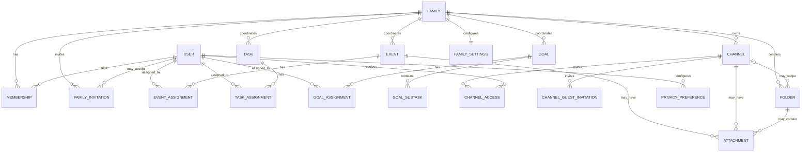

# Document 06 — Domain and Data Model

**Important:** This is a conceptual model inferred from browser labels, forms, and saved-state UI. It is not a verified database schema, table list, or backend contract. The initial pass began with one visible member and empty modules; the later authorized execution pass created synthetic test records and a Child profile. See [execution evidence](10-functional-execution-results.md).

## Entity inventory

| Conceptual entity | Evidence / visible attributes | Ownership and relationships inferred from UI | Confidence / unknowns |
|---|---|---|---|
| Family | Family name; member list; family settings; guest rule | Groups users/members, shared modules, settings, and channels | Inferred; no family editor/backend model inspected |
| User / Family Member | First name, last name, email (Settings invite), optional phone, bio, avatar, age, birthday, profile color; activity counts | A user may be associated with one family or several; relationship cardinality unknown | Fields confirmed on profile/invite forms; persistent entity semantics inferred |
| Membership / Role assignment | Parent (Full access), Child (Limited access), Member, Admin, Owner labels; synthetic Child profile saved and displayed as Child | Connects a user to family with a role; role namespaces may overlap or be independent | Saved Parent-side Child record confirmed; mapping, account activation, and authorization unverified · E-037 |
| Family invitation | First name/email/phone; Member or Admin role; pending invites section | Invites a person to join or access family | Form confirmed; delivery, acceptance, expiration, cancellation unknown |
| Channel guest invitation / guest access | Invite people field; helper says non-family invitees get email to join as guest; guest list says guests see only invited channels | May associate guest with one or more channels, subject to family rule | UI copy confirmed; access enforcement and acceptance unknown |
| Event | Title, type, date/time, recurring end date/time, note, location, attachment, assigned members, private checkbox | Associated with family or user; may be assigned to family members | Saved one-time/recurring records, Parent/Child assignments, location and privacy display confirmed; recurrence semantics and post-save note/attachment persistence unresolved · E-027–E-029 |
| Task | Title/type, description, due date/time, assigned member(s), private checkbox; To Do/In Progress/Completed/Overdue | Shared or private task associated with member(s) and family | Create, edit, To Do → In Progress → Completed, and Parent-side Child assignment confirmed; ownership cardinality and Child enforcement unverified · E-025–E-026 |
| Goal | Title, description, category, priority, Family/Individual type, target date/time, subtasks, Individual assignee, private checkbox | Family goal has no assignment field; individual goal has required member assignment | Family/Individual saves, Parent/Child assignments, and visible completion/progress confirmed; edge calculation and Child enforcement unverified · E-030–E-032 |
| Goal subtask | Text entered through Sub Task and Add; checkbox on saved goal card | Child item of a goal; completion may contribute to progress | Saved subtask and completion transition observed; tested Family goal moved to Completed / 100% after its only subtask was checked · E-030 |
| Channel | Name, emoji, optional image, topic, description, members, messages/replies/reactions | Belongs to a family; may include family members or guests | Channel creation, member addition, message/reply, and like count confirmed; guest access and role enforcement unknown · E-033–E-034 |
| Direct-message conversation | Direct Messages section, selected recipient, message transcript | Conversation with one or more family member(s) | Synthetic Child conversation and Parent-side message confirmed; delivery, read state, and group behavior unknown · E-035 |
| Folder | Required title, emoji, description; navigation distinguishes Channel Folders and Standalone Folders | Could be associated with a channel or family. Exact model not verified. | Standalone folder saved; text file uploaded and found through filter/search/sort. Sharing and hierarchy remain unknown · E-036 |
| Attachment / image | Event attachment drop zone; channel image upload; folder/file-storage concept | May be stored against event, channel, or folder | Synthetic text fixture uploaded to a folder and selected for an event; event attachment persistence was not re-opened. Metadata, limits, storage vendor, and security unknown · E-029, E-036 |
| Personal privacy preference | Per Calendar/events, Tasks, Goals audience: family, selected people, only me | Likely controls data visibility by user and module | UI choices/current state confirmed; enforcement and persistence unknown |
| Private-by-default preference | Sidebar Private Mode helper covers new events, tasks, and goals | Scope may be user or family; relationship to item-level privacy not established | Helper/current display confirmed; storage scope and semantics unknown |
| Family settings | Family name; allow guests in channels | Configuration associated with family | UI fields and copy confirmed; permission to update and enforcement unverified |

## Conceptual entity relationship diagram

All entities and cardinalities in the diagram are **inferred**. In particular, the model of invitations, guests, assignments, attachments, folders, and per-user privacy has not been verified from persisted data.

## Observed lifecycle labels

- **Tasks:** All Tasks; Overdue; To Do; In Progress; Completed. A saved task moved To Do → In Progress → Completed. Whether Overdue is derived from due date is unknown; one displayed task/date/count combination was inconsistent.
- **Goals:** All Pending Goals, Individual, Family, Completed Goal. Metrics include Total, Active, Completed, and Average Progress. Completing the only subtask on a tested Family goal moved it to Completed and 100%; a no-subtask Individual card showed `0 / 0 (%)`. “Pending” and progress semantics outside these states remain unknown.
- **Invitations:** A Pending invites section is present; accepted/rejected/expired states are not shown in this account.
- **Channels/folders/events:** Created channel, conversation, folder, and events displayed in populated states. Their edit/archive/delete lifecycle semantics remain unverified.
- **Recurring event modes:** One Time, Daily, Weekly, Monthly are saveable. Observed occurrences did not match selected recurrence settings, so generation and series-edit semantics remain unknown and may be inconsistent · E-028.

## Data visibility and ownership constraints

- Profile text says that items marked Private are visible only to their owner.
- User privacy controls offer family-wide, selected-people, and only-me visibility for events, tasks, and goals; the current account showed family-wide for all three.
- A Private checkbox was checked by default in opened task, event, and goal forms. The global Private Mode switch appeared enabled and says new items are saved as private while on. Shared test records were saved with per-record Private unchecked; private records remained visibly marked private.
- Shared task, event, and goal records assigned to the synthetic Child displayed the Child avatar in the Parent session. This confirms assignment and Parent-side presentation only; it does not confirm Child visibility.
- These are separate UI signals. Their precedence, defaults for other users, read enforcement, and relationship to assigned members must be clarified.
- Guest helper text says guests see only channels they were invited to; a family switch says channel invitees join only the invited channel when enabled.

## Data-related unknowns

1. Actual database entities, identifiers, required fields, indexes, ownership, retention, and deletion semantics.
2. Whether the Parent/Child roles map to Member/Admin/Owner or to a distinct household role system.
3. Whether family invitations and Add Family Member create the same entity or distinct account/invitation records.
4. Whether tasks/goals/events can be assigned to multiple users and whether assignment implies visibility.
5. Recurrence series storage, occurrence generation, time zones, daylight-saving handling, and edits to a single occurrence versus a series.
6. Goal progress calculation and subtask lifecycle.
7. Channel membership, guest acceptance, message storage, and notification rules.
8. Folder hierarchy, standalone versus channel-scoped relationships, and attachment storage.
9. Privacy preference persistence and the meaning/scope of global Private Mode.
10. Integration vendors and data transmitted to them.

The original platform editor, database configuration, workflow definitions, plugins, and API settings were not available as evidence sources.
