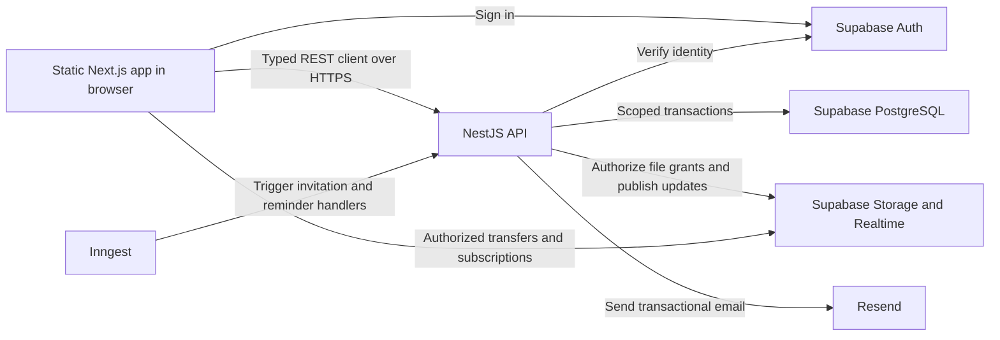

# FamSync implementation plan

**Status:** Implementation underway  
**Delivery:** Static Next.js frontend and a separately deployed NestJS API

**Current product improvement plan:** [Simpler user flows, Today charts, task Kanban drag and drop, and Family Base](ux-dashboard-kanban-family-base-plan.md). The product owner confirmed that homepage analytics belong to the signed-in Today dashboard. That plan defines execution slices E01–E07 separately from the S17 release gate.

## 1. Release objective

The first release should let a family coordinate a week from one place. One member schedules a recurring event, assigns a related task, and sets a reminder. A second member sees the relevant items on Today and completes the task. Both see the updated plan when one occurrence moves or the task is completed.

Use the discovery package as the baseline for existing workflows. This plan prioritizes the changes discussed in chat and defines proposed rebuild behavior where discovery found inconsistent results or incomplete evidence. Legacy cross-member behavior is unresolved and is outside the critical path for kickoff. The rebuild defines and verifies its own access rules. Start with a fresh database and synthetic development and staging fixtures. No existing customer data needs migration. [Discovery index](discovery/README.md) · [Functional requirements](discovery/04-functional-requirements.md) · [Saved workflow evidence](discovery/10-functional-execution-results.md)

## 2. Architecture and stack

| Layer | Implementation |
|---|---|
| Web | Next.js App Router as a static export (`output: 'export'`). Application screens use React Client Components and TypeScript. Use Shadcn Space components, Tailwind CSS, and Lucide icons, plus React Hook Form and Zod for client forms. Use one Shadcn Space primitive family consistently across dialogs, menus, and date controls. [Next.js static exports](https://nextjs.org/docs/app/guides/static-exports) · [Shadcn Space docs](https://shadcnspace.com/docs/getting-started/introduction) |
| API | **NestJS** and TypeScript, deployed as a Node.js container. Start with one API service organized into domain modules. Publish a versioned REST API under `/api/v1` and generate the web client's types and operations from NestJS OpenAPI. [NestJS OpenAPI docs](https://docs.nestjs.com/v11/openapi/introduction) |
| Data and identity | Supabase PostgreSQL and Supabase Auth. Use versioned SQL schema changes, a PostgreSQL connection pool, and parameterized queries in NestJS. Separate local, staging, and production databases and authentication projects. [Supabase database docs](https://supabase.com/docs/guides/database/overview) |
| Files and realtime | Supabase private Storage and private Realtime channels. Keep the canonical message history and file metadata in PostgreSQL. NestJS authorizes file grants and conversation access. [Private Storage](https://supabase.com/docs/guides/storage/buckets/fundamentals) · [Realtime authorization](https://supabase.com/docs/guides/realtime/authorization) |
| Jobs and email | Inngest for schedules and retries, Resend for transactional email, and a PostgreSQL outbox to track work created alongside product changes. Start with in-app and email reminders. [Inngest scheduling](https://www.inngest.com/docs/durable-execution/guides-and-advanced/events-and-triggers/schedules-and-delayed-starts) · [Resend](https://resend.com/nextjs) |
| Delivery and quality | Vercel serves the exported web assets. A managed container host runs NestJS. CI checks the static export, lint, types, schema, and API contract generation. Plan for Vitest on portable business rules and Playwright on multi-account browser journeys. [Vercel deployments](https://vercel.com/docs/deployments) · [Playwright docs](https://playwright.dev/docs/intro) |

Use one TypeScript workspace with `apps/web`, `apps/api`, `packages/api-client`, and `supabase/` for tracked SQL and seed fixtures. Group NestJS code around identity and families, calendar, tasks, goals, conversations, storage, notifications, and the Today read model. NestJS owns all FamSync application server code, including API routes, server-side validation, authorization, database access, jobs, and webhooks. Deploy Next.js as the generated `out/` assets. Application data loads in the browser through the generated NestJS client. Keep API routes and request-time rendering, Server Actions, and middleware out of `apps/web`.

Use fixed exported routes for the authenticated sections and auth callbacks. Parse browser query parameters for records created after deployment, such as `/calendar?event=<id>`. Process sign-in, invitation, and recovery links in browser screens that call Supabase Auth or NestJS as appropriate. [Next.js static export constraints](https://nextjs.org/docs/app/guides/static-exports#unsupported-features)

The browser uses Supabase Auth for sign-in and passes its access token to NestJS as a bearer token. Supabase is also used for approved file transfers and private realtime subscriptions. Configure CORS on NestJS for the allowed frontend origins. Keep privileged keys in the API and job environments.

Start with a private PostgreSQL schema for application data. Give the NestJS runtime connection a role that is subject to row-level security and separate it from the schema owner and job roles. Verify the Supabase JWT signature, issuer, audience, and expiry in NestJS. Resolve current role and membership from the database. Set the verified actor context for each database transaction and derive access from current membership, audience, and conversation participation. Include a check that pooled connections clear actor context between requests. Keep public API responses and action-specific checks in NestJS. [Supabase JWT reference](https://supabase.com/docs/guides/auth/jwts) · [PostgreSQL row-level policies](https://supabase.com/docs/guides/database/postgres/row-level-security)

## 3. Milestones and acceptance gates

M0 and M1 establish the shared foundation. M2 delivers the first pilot. M3 and M4 expand product coverage and can run in parallel once their dependencies are ready. Plan for M1 through M4 to be available at broader launch, with M5 as the release gate. Each milestone includes an outcome that can be demonstrated in staging.

### M0 — Foundation

- Set up the workspace, a local Supabase stack, deployment environments, CI, and seeded test families. Publish the static web shell and deploy the NestJS health endpoint separately to staging.
- Establish responsive navigation and shared Shadcn Space components for forms, dialogs, dates, loading, empty states, errors, and success feedback. Give icon controls accessible names and define keyboard and focus behavior.
- Define API conventions for request validation, field errors, access denials, pagination, idempotent submissions, and request IDs. Generate the first web client from OpenAPI and check it in CI.
- Serve the exported assets from a static host in CI. On staging, prove a signed-in browser can call the deployed NestJS API, use a scoped database connection, and render the result. Verify that directly opening a record link or an auth callback URL loads the right screen. Verify credentials and records are isolated between environments.

### M1 — Accounts, family membership, and privacy

- Implement sign-up, sign-in, sign-out, recovery, email and password changes, family creation and joining, profile details and avatar, and the family settings screens. Keep household labels such as Parent and Child separate from permissions. Write the rebuild's role matrix and enforce it in the API and database.
- Build family email invitations with pending, accepted, expired, and revoked states, plus resend. Verify the recipient at acceptance and consume the invitation in the same transaction as membership creation. Verify delivery using Mailpit locally and Resend in staging. Surface delivery failures to owners with a resend option. Introduce the authenticated Inngest handler and outbox in S10 when scheduled reminders first need background delivery and retries.
- Implement family name and time zone, member list, member removal, role changes, and owner transfer. Define visibility controls for Family, Selected members, and Only me. Show the effective audience before saving. Profile defaults and Private Mode prefill new items. Changing a default leaves existing audiences intact.
- **Acceptance gate.** Two test accounts can join the same family and use their assigned permissions. An unrelated family cannot read its data. An Owner cannot open a member's Only me record. A revoked or expired invitation cannot be redeemed. [Role discovery](discovery/08-roles-permissions.md)

### M2 — Today, Calendar, Tasks, and reminders

| Workstream | Build | Acceptance gate |
|---|---|---|
| Today | My items and Whole family views, upcoming schedule, due today and overdue work, quick create, complete, and reschedule actions. Show a goal summary when M3 is available. Use the same filtered data and business rules as the source modules. | Today, the task board, and Calendar agree after an authorized change. Private items are omitted from other users' results and counts. |
| Calendar | Month and mobile agenda views, one-time and daily, weekly, and monthly events, all-day support, attendees, note, location, and attachments. Preview upcoming occurrences. Support editing or cancelling one occurrence and editing the series. | A Monday series falls on Mondays up to and including its cutoff date. Moving or cancelling one occurrence leaves the others intact. A saved note and attachment are still visible after reopening the event. |
| Tasks | Board and List, suggested or custom titles, clear ownership, due date, description, recurrence, reassignment, To Do → In Progress → Completed, undo, and archive. Link a task to an event or an individual occurrence. | Complete or reopen a task from Today and see the same status and overdue count on the board. Completing a recurring chore affects only that occurrence. Undo restores the previous state. |
| Reminders | In-app and email delivery, quiet hours, preferences, and reminder scheduling from events and tasks. Set up assignment and event change notifications. | A rescheduled or cancelled occurrence updates its pending reminder. A repeated job or request does not send a duplicate under normal retries. A removed recipient receives no new reminder for the item. |

**Core pilot gate.** An organizer schedules weekly sports practice, assigns the kit task to another member, moves one practice, and confirms the assignee sees the update on mobile. The assignee completes the task and both accounts see the result. A third account from another family sees none of these records. [Calendar and task evidence](discovery/10-functional-execution-results.md)

### M3 — Goals and progress

- Add Family and Individual goals with category, priority, target date, assignment for Individual goals, subtasks, edits, and progress summaries. In the checklist mode, show completed items over total and complete the goal when all items are done.
- Support goals without subtasks through manual completion. Add numeric targets such as books read and the option to link existing tasks to a goal. Keep completion and reopening consistent when underlying progress changes.
- Add goal progress to Today and derived activity counts to Profile. Require matching audiences for task links and recheck the link when either item's audience changes. This prevents shared progress from revealing the activity of a private task.
- **Acceptance gate.** Empty checklists display a clear state. Checklist, manual, and numeric goals can complete and reopen correctly. Completing a linked task updates goal progress once. Progress and counts respect the saved audience.

### M4 — Channels, direct messages, and family storage

- Build channel creation and edit, topic and description, icon or image, member management, search, messages, replies, and reactions. Implement one-to-one DMs, unread state, mentions, and mute. Add actions to create a task from a message or link a message to an event. Preserve source access when showing links and previews.
- Allow channel-specific guest invitations when enabled in family settings. Guest access applies only to explicitly granted channels and their visible files. Disabling guest access revokes those grants and pending guest invitations.
- Expand the attachment capability from M2 into family folders and channel folders. Add upload progress, retry, file listing, type filters, filename search, sorting, preview or download, and archive or delete where authorized. Render the updated list on upload completion.
- **Acceptance gate.** Two participants can exchange messages across separate sessions, restart or reconnect, and still see message history and unread state. A channel guest sees only the invited channel and its authorized files. An uploaded document is immediately visible, searchable, and downloadable by an eligible member.

### M5 — Pilot expansion and launch

- Run scripted scenarios with controlled accounts and a small family pilot on mobile and desktop. Review recurrence, reminder delivery, invitation recovery, account and membership changes, privacy, and upload failure recovery.
- Set up error and job alerts, deployment and rollback runbooks, production backups and a restore rehearsal. Seed staging with representative records for several families and measure Today response time, calendar range queries, and chat history loading before setting performance targets.
- Track first shared action, first completed coordination flow, and weekly active families. Count a family as activated once two distinct members take a coordination action in the same family. Keep message content, filenames, and invitation addresses out of analytics.
- **Launch gate.** The core pilot journey and the release's committed module checks pass in staging. Critical privacy, recurrence, and delivery defects are resolved. Support can diagnose a failed invite, reminder, or upload using status and request IDs.

## 4. Business rules and data design

These defaults are proposals for the rebuild. Review them before starting the milestone that depends on them. [Domain discovery](discovery/07-domain-data-model.md) · [Open questions and rebuild gaps](discovery/09-rebuild-scope-gap-analysis.md)

| Area | Proposed rule and implementation |
|---|---|
| Family roles | Use Owner, Admin, Member, and Restricted for family membership. Use Parent and Child as household labels. Owner manages ownership. Admin can manage members and invites within granted authority. Member can coordinate shared work. Restricted members can view permitted items and complete assigned work. Guests use channel grants. The M1 role matrix must specify who can create, edit, and remove each item. |
| Audience and assignment | Store record audience separately from assignees or attendees. Assignments must reference an eligible member who can see the item. If changing an audience removes access for an assignee, show the conflict and require reassignment or a compatible audience before saving. Restrict private items, counts, search results, attachment links, and notifications using the same audience rule. |
| Recurrence | Persist a series, its local start and IANA time zone, an optional end date, and exceptions keyed by original occurrence. Keep all-day dates as dates. Expand instances within the requested calendar window. Preserve local wall time across daylight-saving changes where possible. Show the rule in the preview and skip nonexistent day-of-month dates, such as February 31. Use the same occurrence engine for the preview, Calendar, Today, and reminders. [iCalendar recurrence reference](https://www.rfc-editor.org/rfc/rfc5545.html) |
| Tasks and overdue | Persist status, assignee, completion, and deadline. Derive Overdue for unfinished, unarchived tasks with a deadline before the current time. Date-only tasks become overdue at the end of their due day in the relevant family time zone. Allow past dates with explicit feedback. Deduplicate the task suggestion catalog. |
| Goal progress | Checklist progress uses completed over included steps. Archived task sources are excluded until restored; an empty or fully excluded checklist stays active without a percentage. A goal with no subtask can use manual completion. Numeric goals use current value against a positive target. Exclude goals without a numeric percentage from average progress. Reject cross-audience task links. |
| Messaging and files | Persist a message before broadcasting. Use an ordered cursor and a client message ID so retries do not create duplicates. Broadcast content-free refresh signals on private topics and fetch current content through NestJS. Authorize file transfers against the parent event, folder, or conversation and confirm uploads before listing them. Use short-lived signed grants where an expiry window is acceptable and a fresh access check on download where immediate revocation is required. Validate file size and type, and clean up abandoned uploads. |
| Jobs and delivery | Write pending notification work in the same transaction as its source change. A dispatcher retries pending work. Before delivery, check the current revision, recipient access, reminder preference, and quiet hours. Use a stable notification key and provider idempotency when available. Record application state separately from provider delivery status. |

**Data groups.**

- Identity and family access use profiles, families, memberships, invitations, audience grants, and user preferences.
- Coordination uses event series and exceptions, event attendees, tasks and recurring task instances, goal records, goal checklist entries, and task links.
- Communication uses channels and channel memberships, DM conversations and participants, messages, reactions, and read cursors.
- Storage and delivery use folders, file metadata and attachments, notification records, reminder schedules, outbox records, and audit events for membership and sharing changes.

Scope shared records to a family. Use foreign keys or transaction checks to prevent references across families and unique constraints for duplicate membership, reactions, recurring instances, and message retries. Keep authenticated user IDs distinct from membership IDs. Prefer archive or cancellation for normal user actions so linked tasks, reminders, and history have defined behavior.

## 5. Verification and discovery traceability

| Discovery area | Implementation milestone | Requirement references |
|---|---|---|
| Dashboard, schedule, quick tasks, and navigation | M2 · Goal summary in M3 | FS-001–FS-002 |
| Task views, suggested and custom titles, assignment, edits, and status | M2 | FS-003–FS-005, FS-022 |
| Calendar views, dates, recurrence, and event details | M2 | FS-006–FS-007, FS-023 |
| Goal types, assignees, subtasks, and progress | M3 | FS-008–FS-009, FS-024 |
| Channels, family membership within channels, guest invitations, messages, and DMs | M4 | FS-010–FS-012, FS-016, FS-025–FS-026 |
| Folders and file operations | M2 attachment foundation · M4 full storage experience | FS-013, FS-027 |
| Family settings, invitations, profile, privacy, account actions, and Child assignment | M1 · Guests in M4 · Goal activity in M3 | FS-014–FS-020, FS-028 |
| Authenticated entry, public entry, and onboarding | M1 | FS-021 |

Use unit coverage for recurrence, due dates, progress, and state changes. Use integration coverage against PostgreSQL for invite redemption, actor isolation, concurrent changes, and job retries. Use independent browser sessions for the family pilot journey, restricted access, unrelated families, guest access, messaging, and files. The highest-priority access cases compare an authorized member with a different family, a removed member, and a nonparticipant. Check shared views, count totals, notifications, files, and realtime subscriptions in addition to page routes.

The observed defects serve as focused acceptance cases. Test weekday alignment and multi-day recurrence from E-028, zero-subtask goals from E-031, save versus edit feedback from E-025, and immediate file-list refresh from E-036. For the event in E-029, explicitly verify that both note and attachment can be reopened after saving. [Execution ledger](discovery/10-functional-execution-results.md)

## 6. Decisions to make during delivery

| When | Decision | Starting proposal |
|---|---|---|
| Before M0 deployment | API host, deployment region, and environment domains | Vercel for static web assets and one managed container service for NestJS. Choose compatible regions for the API and PostgreSQL. Configure the approved web origins and auth callback URLs for each environment. |
| Before M1 role setup | Child account activation and actions that Restricted members can take | Start with invited, controlled logins and a restricted permission set. Decide whether to add managed profiles without sign-in before enabling that flow. |
| Before M1 sharing | Default audience and when organizers can change an item's audience | Start with Family visibility for ordinary coordination and show it on the form. Only the creator or an explicitly authorized editor can widen an item's audience. |
| Before M2 recurrence | Daylight-saving boundaries and what happens to linked tasks when an occurrence moves | Define ambiguous and nonexistent local-time handling through dated fixtures. Offer to shift an occurrence-linked task by the same interval, with a preview before applying changes. |
| Before M4 rollout | Guest capability, upload limits and types, and retention | Default guest access off. Start with read and reply access to explicitly shared channels, subject to product approval. Set file limits and document how archives, deletions, and revoked guest access affect existing files. |

**Later product scope.** Consider native apps, web push, calendar-provider sync, group DMs, and additional reminder channels after the pilot identifies demand. Billing was outside the verified discovery scope and requires a separate product decision.

## 7. Plan and deliver one slice at a time

An execution slice is a bounded piece of work with an outcome we can demonstrate. Before writing code for a slice, share its plan with the product owner. Include the outcome, affected screens and modules, API and data changes, dependencies and decisions, and concrete checks for completion. Spell out how to recover from a failed deployment or schema change when that matters.

After execution, review the result against the slice plan and report the evidence and any open issues. Use those findings to plan the next slice. If a discovery changes the current slice's outcome, dependencies, or acceptance criteria, update the plan before implementing the change.

| Slice | Milestone | Demonstrable outcome |
|---|---|---|
| S01 | M0 | **Complete.** A static Next.js shell and a separate NestJS service run locally from the same workspace. |
| S02 | M0 | **Complete locally.** The Supabase schema is reproducible, and the static browser app reaches NestJS through the generated OpenAPI client. Separate staging configurations are prepared. |
| S03 | M1 | **Complete locally.** Two accounts can sign in and manage their own profiles. Email and password flows and profile isolation are verified. |
| S04 | M1 | One user creates a family and another joins through a real test invitation. Validate the authenticated flow in staging and enforce family isolation. |
| S05 | M1 | An owner manages members and settings. Role and audience rules protect private and selected-member items in the first feature slices. |
| S06 | M2 | A member creates a one-time event with a note, location, or attachment and can reopen it in Calendar and Today. |
| S07 | M2 | A member schedules a series, previews its dates, and moves or cancels one occurrence. |
| S08 | M2 | A member assigns, completes, and reopens a task. Today and the task views agree on its status and overdue count. |
| S09 | M2 | A member completes one occurrence of a recurring chore and can link a task to an event occurrence. |
| S10 | M2 | Add the authenticated Inngest handler and outbox. Verify the correct reminder reaches the right member after an occurrence moves, then walk through the core pilot with two accounts. |
| S11 | M3 | **Complete locally.** Manual, checklist, and numeric goals support completion, reopening, editing, archive/restore, and visibility-aware summaries in Goals and Today. |
| S12 | M3 | **Complete locally.** Linked tasks drive checklist progress atomically; Profile shows visible own task and goal activity across current families. |
| S13 | M4 | **Complete locally.** Private participant channels support persisted messages, replies, reactions, unread state, and live refresh through the outbox. |
| S14 | M4 | **Complete locally.** Members exchange private DMs, search messages, mute alerts, mention participants, and link messages to audience-checked tasks and events. |
| S15 | M4 | **Complete locally.** Managers invite channel guests under the owner's policy; verified recipients participate only in granted channels, with revocation and isolated work previews. |
| S16 | M4 | Members upload, find, and download files in family and channel folders using the attachment foundation from S06. |
| S17 | M5 | Pilot families complete the release scenarios, and the team rehearses deployment recovery and support triage. |

### S01 plan — Web and API foundation

- **Deliverables.** Set up the TypeScript workspace with `apps/web` and `apps/api`, a lockfile, and root commands for local development and builds. Add a small responsive web shell with Shadcn Space, Tailwind, and Lucide. Give NestJS a basic health endpoint.
- **Boundary.** This slice covers the local app shells. S02 covers the database, generated client, and first browser-to-API connection.
- **Completion checks.** Both apps start locally. The web build produces `out/` and the shell loads from a static file server. The independently running NestJS service returns an HTTP 200 from its health endpoint. A developer can repeat the setup using the repository instructions.

**S01 result.** npm workspaces provide the shared lockfile and commands. The root build produced static Home and Today pages, and both returned HTTP 200 from a static file server. The independently running NestJS service returned HTTP 200 with `{"status":"ok"}` at `/health`. Playwright verified the Home layout at desktop and mobile widths, the Today link, and zero browser console errors after the fixes. The web scripts use Webpack because the Turbopack CSS worker failed on this Windows setup. [Local setup instructions](../README.md)

### S02 plan — Local database and typed API connection

- **Outcome.** Recreate a fresh local Supabase database from tracked schema files and prove that the exported web app can reach the independently running NestJS API through a generated client.
- **Deliverables.** Set up a local Docker Compose workflow using Supabase PostgreSQL and keep the schema and fixtures in the Supabase CLI project layout. Add NestJS database configuration and a readiness check, OpenAPI generation into `packages/api-client`, a browser origin allowlist, and separate deployment configuration for the static web app and API.
- **Dependencies and decisions.** Verify that the local Docker daemon is available. Confirm the staging API host and frontend origins before provisioning staging. Use a local browser check for the initial API call.
- **Completion checks.** Rebuild the local database from the tracked files, start NestJS with the documented configuration, and verify its database readiness response. Generate the client and call a typed endpoint from the exported web app on the allowed origin. Confirm a browser request from an unapproved origin is blocked by CORS.

**S02 result.** Windows Application Control blocked the native Supabase CLI, so the local database uses the official Supabase PostgreSQL image with Compose. A clean rebuild seeded one family, and the restricted API login saw zero family rows. The static Today page called NestJS through the generated OpenAPI client and showed the recovery message during HTTP 503. It returned to its regular view after readiness recovered to HTTP 200. Chrome blocked the same call from an unapproved origin. The standalone API image also built and returned HTTP 200 against the local database. The staging host and web origin remain deployment decisions. [Local and staging setup](../README.md)

### S03 plan — Sign-in, profile, and account settings

- **Outcome.** A person signs in from the static web app, views or edits their own profile, and signs out. The browser sends its access token with calls to the NestJS API.
- **Deliverables.** Set up a local Supabase Auth endpoint and mail capture for development. Add sign-up, sign-in, confirmation and recovery screens, and account actions. Add a private profile table keyed to authenticated user ID, a NestJS token guard, and typed self-profile endpoints. Use the current authenticated actor for profile reads and writes in the database.
- **Dependencies and decisions.** Extend the local Docker workflow with Auth and local mail delivery. Configure the allowed callback URLs and the expected token issuer and audience. Use email and password for this first sign-in flow.
- **Completion checks.** In the exported web app, create and confirm a local test account, sign in, update a profile, and confirm that the profile persists after reload. Verify password recovery and sign-out. Check that NestJS denies missing or invalid tokens, and that another test account cannot read or change the first user's profile.

**S03 result.** The production build exported the account and Auth pages as static assets. The local migration now runs as the existing Supabase schema owner and preserves the seeded family on repeated runs. In two isolated Chrome sessions, synthetic accounts confirmed sign-up through Mailpit, saved and reloaded their profiles, and could not read or change each other's profile. NestJS rejected missing and altered bearer tokens. The browser checks covered sign-out, password recovery and sign-in with the recovered password, signed-in password change, and email change requiring confirmation at both addresses. The original profile persisted after sign-in with the new email and password. PostgreSQL checks also confirmed that unauthorized profile rows were hidden, cross-account writes affected zero rows, and actor scope cleared after both commit and rollback. The account screen fit a 390 px viewport without horizontal overflow. [Local setup](../README.md)

### S04 plan — Family workspace and invitation

- **Outcome.** A signed-in user creates a family workspace as its owner. A second user redeems an invitation and can open that workspace.
- **Deliverables.** Add memberships and invitations with expiry and revocation, and make family creation and owner membership atomic. Build the NestJS endpoints and static screens to create a family, list a user's families, invite by email, and accept an invitation. Retain the pending invitation across sign-in and email confirmation in the browser. Store only an invitation token digest and bind redemption to the verified recipient. Use Mailpit to verify delivery locally.
- **Dependencies and decisions.** Reuse S03 sessions, the typed API client, and PostgreSQL actor scope. Start with owner and invited member capabilities so family access can be verified. The staging host and origins are prerequisites for repeating the workflow against hosted services.
- **Completion checks.** Use isolated browser sessions for the owner, invitee, and an unrelated account. Verify the owner creates the family and sends a real local email. Before redemption the invitee cannot open the workspace. After redemption both members see it and the unrelated account still cannot. A reused, expired, revoked, or wrong-recipient link does not grant membership.

**S04 result.** The static export added family list, workspace, and invitation pages. The NestJS API and PostgreSQL migration create the owner with the family and accept invitations in the same transaction as membership creation. In three isolated Chrome sessions, a real Mailpit invitation survived sign-up and email confirmation in a second tab. Sign-in also returned to a pending invitation. Members could open the family after joining, and invitation management stayed with the owner. A wrong recipient, revoked or expired link, link replaced by resend, or replay could not redeem an invitation. A simulated SMTP outage left a saved invitation that the owner successfully resent. Direct PostgreSQL checks confirmed family isolation and verified the runtime role cannot read token digests. The owner and member views fit a 390 px viewport.

**Deployment.** NestJS sends invitation email after the database transaction commits and records the result for manual resend. Mailpit was verified locally. Hosted Resend delivery and the staging acceptance check are pending the staging API host, web origin, and verified sender. Background delivery with Inngest and the outbox is planned for S10. [Mail configuration](../README.md#staging-configuration)

### S05 plan — Family settings, members, and privacy rules

- **Outcome.** An owner can manage the workspace and its members. Calendar, Tasks, and Goals can reuse a single definition of who may see an item.
- **Deliverables.** Add static family settings and a member directory backed by typed NestJS endpoints. Let the owner edit the family name and time zone, remove a member, and transfer ownership atomically. Publish the permission matrix for Owner and Member and keep household labels separate. Store per-module visibility defaults and Private Mode. Define the Family, Selected members, and Only me rules in PostgreSQL for reuse as each feature's tables are added.
- **Decisions.** The current owner becomes a member after a transfer. Private Mode prefills new items as Only me. An explicit item audience takes precedence over defaults, and changes to defaults leave saved audiences intact. Selected-member access requires current membership in the item's family.
- **Completion checks.** Verify settings, member access, ownership transfer, and removal with two family accounts and an unrelated account. Verify the former owner loses administrative actions immediately and a removed member loses access. Exercise all three audience rules using database fixtures, including a private record hidden from the family owner. Verify the rules again through each feature's list, detail, and summary endpoints when those features ship.

#### Family permissions

| Action | Owner | Member | Account outside the family |
|---|---|---|---|
| Open the workspace and see member names and roles | Yes | Yes | No |
| See member email addresses in the directory | Yes | No | No |
| Edit family name and time zone, manage invitations, or remove a member | Yes | No | No |
| Transfer ownership to a current member | Yes | No | No |
| Read a saved family item | By its audience | By its audience | No |
| Manage personal privacy preferences | Own account | Own account | Own account |

Owner and Member are workspace permissions. Household labels such as Parent and Child serve as descriptions. A family has one owner, and the previous owner becomes a member when the transfer commits. Member removal also revokes outstanding invitations to that person's current email address.

Preferences start at Family for Calendar, Tasks, and Goals, with Private Mode off. A Selected members default prompts the author to choose recipients for the current family. Private Mode starts a new item at Only me, and the author can pick a different audience before saving. Saved audiences control reads independently of preference changes. Any viewer needs a current membership, including the author. Owners follow the same audience rules as members.

**S05 result.** In three isolated Chrome sessions using the static export, an owner changed the family name and time zone, managed the member directory, and transferred ownership. The former owner lost administrative access immediately. Removal blocked subsequent workspace and directory requests from the existing session and revoked a pending rejoin invitation. Concurrent transfer and removal requests preserved a single owner. The member directory hid email addresses from members, and names and roles remained readable on a 390 px viewport. Account privacy preferences persisted after reload.

PostgreSQL fixtures exercised Family, Selected members, and Only me through row-level security, including owner exclusion from another member's private item, recipient validation, immediate loss of access after removal, and preference isolation. The privacy defaults and audience rules are ready for Calendar to use in S06.

### S06 plan — One-time events and attachments

- **Outcome.** A member creates a one-time event and reopens it from Calendar and Today with its saved details.
- **Deliverables.** Add one-time timed and all-day events with a title, note, location, and optional attachment. Add a static Calendar month and agenda view and use the same NestJS event queries for the schedule section of Today. Keep PostgreSQL as the source for event and attachment metadata and set up local private Supabase Storage with short-lived grants issued by NestJS.
- **Decisions.** Use the family time zone for display and day boundaries. Apply the S05 defaults to new drafts and show the effective audience and selected recipients before save. Bind the creator to the current actor and validate selected recipients when saving. Authorize event detail, list, Today summaries, and attachment access against the same audience. S07 adds recurring events.
- **Completion checks.** In the exported app, create and reopen timed and all-day events with two family accounts. Verify notes, locations, and attachments persist, shared events appear in Calendar and Today, private and selected audiences apply across all entry points, and unauthorized accounts cannot use attachment grants. Include a time-zone boundary and mobile layout check.

**S06 result.** The static build exported Calendar, Today, and event detail pages. In four isolated Chrome sessions, an owner and a member created timed and all-day events and reopened their saved details from Calendar and Today. The test covered a selected recipient, a family member outside the selected audience, and an account outside the family. List counts, direct detail links, and attachment grants respected the saved audience. The owner remained unable to access another member's Only me event.

Local Supabase Storage served the private attachment with its original filename and content through a 60-second download URL. NestJS accepts one attachment up to 5 MB on save. An oversized file and a simulated storage outage left no partial event, and concurrent retries produced one event. Time checks covered a family date crossing UTC midnight and rejected skipped or repeated local times at daylight-saving transitions. The mobile agenda and detail views fit a 390 px viewport. Hosted Storage verification is pending staging configuration. [Local and hosted setup](../README.md)

### S07 plan — Recurring events and occurrence changes

- **Outcome.** A member can preview and save a recurring schedule, then move or cancel one occurrence from Calendar.
- **Deliverables.** Add daily, weekly, and monthly recurrence with intervals and an end date. Store a recurrence rule on the series and store single-occurrence changes against the occurrence's original date and time. Return one-time events and occurrences together from the schedule query used by Calendar and Today. Add a preview that uses the same expansion logic as the schedule.
- **Decisions.** Evaluate a timed series in the time zone chosen when it was saved to preserve its local start time across clock changes. Treat the end date as inclusive. Monthly day-of-month patterns skip months that lack that date. Keep one occurrence's identity after it moves so later changes affect the same occurrence. Apply the series audience to occurrences and their attachments.
- **Completion checks.** Preview and save a Monday series through its cutoff date, then move one occurrence and cancel another. Verify both Calendar and Today reflect the changes. Exercise a month with a missing day, a daylight-saving boundary, and a multi-day occurrence. Verify that an account outside the series audience sees no occurrences, details, or attachment grants.

**S07 result.** Using the static export in three isolated Chrome sessions, an owner previewed a weekly series of four Mondays through its inclusive cutoff, saved it with an attachment, moved the first occurrence and cancelled the second. Calendar and the member's Today on a 390 px viewport opened the moved occurrence under its original identity, and the member saw no move or cancel controls. The schedule query returned only the moved and remaining occurrences, and a stale move could not revive a cancellation. A cancelled occurrence issued no attachment grant. A monthly series anchored on January 31 skipped February and kept its multi-day duration. A moved multi-day occurrence appeared only in its new window. The owner could not view or obtain grants for a member's private daily series, and an outsider received no occurrence or grant. One-time events behaved as before. Changing the family time zone left a timed series on its saved zone. Unit checks cover weekday alignment, missing monthly dates, local time across daylight-saving changes, and multi-day overlap. A timed occurrence whose local start falls in a daylight-saving gap is skipped. The decision for M2 recurrence in section 6 should confirm this or replace it with a shift forward. Editing a whole series, attendees, and the My items and Whole family Today views are not yet assigned to a slice.

### S08 plan — Task assignment and status

- **Outcome.** One family member assigns a task and another completes or reopens it from Tasks or Today. Both views reflect the same status and overdue count.
- **Scope.** One-time tasks with a title, description, optional due date and time, optional assignee, and audience. Board and List views, status filters with counts, edits by the author, status changes with undo, and a Today task section. Recurring tasks, event-occurrence links, and archive move to S09. Reminders and assignment notifications stay in S10. Profile activity counts stay in S12.
- **Screens.** Add a static `/tasks/` route that uses the `?family=` parameter and a `/task/` detail route with `?family=&id=` so direct links load after deployment. Add Tasks to the main navigation. The Tasks screen has All, Overdue, To Do, In Progress, and Completed filters with counts and a Board/List toggle that is remembered per browser. On a 390 px viewport the board stacks its status columns vertically without horizontal scroll. The New task dialog has a title field with the grouped suggestion catalog plus free text, description, due date with an optional time, assignee, and audience with the effective recipients shown before save. The detail page shows status actions and edit for the author. Today gains a section for tasks due today and overdue, with My items as the default, a Whole family filter, and Complete and Reopen actions. It also adds Active and Overdue counts.
- **Data.** Add a migration `create_tasks` with an `app.tasks` table holding a client-supplied UUID, family, author, title (1–120 characters), description (up to 2,000 characters), status (`todo`, `in_progress`, `completed`), and an optional `due_date` or `due_at`, but never both. It also holds assignee, audience and selected members, `completed_at` and `completed_by`, a `version` counter, and timestamps. Row-level security reuses `app.can_view_family_item` for reads and `app.can_set_family_item_audience` for writes. Separate update policies let the author change details and the author or assignee change status. The insert and update policies reject an assignee who is not a current member able to see the task. Index by family with status and due date. Extend member removal to clear the assignee on that member's open tasks in the same transaction. The `tasks` privacy default already exists from S05.
- **API.** Add a `TasksModule` under `/api/v1/families/:familyId/tasks`:
  - `GET` lists tasks with `status`, `overdue`, `assignee=me`, and cursor pagination.
  - `GET summary` returns counts for the filters and Today from one query.
  - `GET defaults` returns the audience default and the eligible assignees.
  - `POST` creates a task. Retrying with the same ID returns the original task.
  - `GET :taskId` returns task details.
  - `PATCH :taskId` lets the author edit details, assignee, and audience.
  - `PUT :taskId/status` changes status.
  
  Edits and status changes carry the `version` they were based on and return HTTP 409 when another change landed first. The API derives overdue status at read time and returns it with each task. Regenerate the OpenAPI client.
- **Rules.**
  - A task is overdue when it is not completed and its due time has passed. For a date-only task, that is the end of its due day in the current family time zone.
  - Completing a task records who completed it and when and clears its overdue status. Reopening returns it to To Do and clears the completion.
  - Undo sends the previous status as a normal status change, so it is subject to the same permission and version checks.
  - Past due dates are allowed with a visible warning that the task will save as overdue.
  - A private task can only be assigned to its author. A selected-members task can only be assigned to the author or a selected member.
  - An audience change that would hide the task from its assignee is rejected with a message asking for reassignment first.
  - Save and edit show distinct confirmations, covering E-025.
  - The suggestion catalog lives in the web bundle, grouped as in discovery Appendix A, with duplicates such as “Behavior goals” removed.
- **Dependencies.** S05 audience rules and privacy defaults, the family time zone, the S03 token guard, and actor scope. The Owner and Member roles are enough for this slice. The Restricted role remains an M1 decision before Child accounts can complete their own tasks.
- **Decisions for the product owner.** Approve these starting proposals before implementation:
  1. A due date can have an optional time.
  2. Only the author edits details and assignment. Owners get no override on other members' tasks.
  3. The author and the assignee can change status. Other viewers can only view.
  4. Removing a member leaves their open tasks unassigned rather than reassigning them.
  5. Archive moves to S09.
- **Completion checks.**
  - **Unit:** checks cover the overdue rule, including a date-only task at the family's end of day, a timed task, a daylight-saving day, past dates, and completion clearing overdue status. They also cover the allowed status transitions and the version conflict.
  - **PostgreSQL:** checks confirm that an outsider and an excluded selected member see no rows. They also confirm that the owner cannot read a member's private task, that an ineligible assignee or an assignee-hiding audience change is rejected, and that a non-assignee viewer cannot change status. Removing a member must unassign their open tasks.
  - **Browser:** an `s08-smoke.js` run uses isolated sessions for an owner, a member on a 390 px viewport, a family member outside a selected audience, and an outsider. The owner creates a task due today and assigns it to the member. The member completes it from Today and the owner reopens it from Tasks. Undo restores the previous status, and a stale second tab gets a conflict instead of overwriting. After reload, Today, the board, the list, and the summary agree on status and on the Active and Overdue counts. A past-due date-only task counts as overdue in every view. Direct `/task/` links respect the audience, and the browser logs no errors.
  - The recurrence unit tests and the S07 smoke run still pass.
- **Recovery.** The migration only adds a table, policies, and a change to the member-removal function. It can be reversed by a follow-up migration that restores the previous function and drops `app.tasks`. No production data exists yet.

**S08 result.** The product owner approved the five proposals as written.

- **Build.** The static build exported Tasks and task detail pages. The migration `20261118000000_create_tasks.sql` adds `app.tasks` with row-level security. A trigger records completion, bumps the version, and blocks detail edits by anyone other than the author. Member removal now unassigns that member's open tasks. The task form reads eligible assignees from the member directory, and PostgreSQL enforces the same rule. `GET defaults` returns only the audience default.
- **Browser check.** The run used four isolated Chrome sessions: an owner, a member on a 390 px viewport, a family member outside a selected audience, and an outsider.
  - The owner filled a title from a suggestion and replaced it with custom text. They then assigned a task due today and a task due yesterday to the member. The form warned before saving the past-due task, and both Tasks and Today marked it overdue. A retried create returned the original task.
  - The member completed the due-today task from Today, undid the change, and completed it again, and the result survived a reload. Today's Active and Overdue counts matched the summary API for the member's items.
  - The owner reopened the task from the board's Completed column. After reload, the filter counts, columns, and Overdue list agreed, and the browser remembered the List layout.
  - A stale detail tab got a conflict message and reloaded instead of overwriting a newer status. An edit showed “Changes saved” rather than the create confirmation, which covers E-025.
  - The owner could not open the member's private task, and the excluded member could not open a selected task by API or direct link. The outsider could not list tasks. A non-assignee viewer could not change status, and an assignee could not edit details. An audience change that would hide the assignee returned a conflict.
  - Tasks and Today fit the phone viewport, and the browser logged no errors.
- **Automated checks.** Unit checks cover the overdue rule, including the family's end of day, timed tasks, daylight-saving days, completion, and past dates. They also cover due-time validation and page cursors. `npm run db:test` exercises the same access rules against the restricted role and confirms that removing a member unassigns their open tasks. The S07 browser check and the recurrence unit checks still pass.
- **Open items.** A timed due date keeps its saved local date and instant. If the family later changes time zone, the date label stays the same while the time displays in the new zone. Hosted verification waits on staging. S09 adds recurring tasks, event-occurrence links, and archive.

### S09 plan — Recurring chores, event links, and archive

- **Outcome.** A member completes one occurrence of a recurring chore without affecting the others. A task can be linked to an event or to one event occurrence. When the event creator moves that occurrence, they can shift the linked task's due date by the same amount. Authors can archive and restore tasks.
- **Delivery.** Deliver in two parts with separate checks to keep each change reviewable:
  - **S09a:** recurring chores and archive.
  - **S09b:** event links and the shift offer.
  
  S09b depends on S09a only for the archive rules.

#### S09a — Recurring chores and archive

- **Model.** A recurring chore is a series, and each due date is its own task row. Every occurrence reuses the S08 rules for status, version conflicts, undo, overdue, counts, Today, and permissions. Completing one occurrence changes only that row.
- **Screens.**
  - The New task form gains a Repeat control (Does not repeat, Daily, Weekly, Monthly), an interval, an optional end date, and a preview of the next eight due dates.
  - Task cards and the detail page show a repeat indicator and the rule. On an occurrence, the author sees Edit this occurrence and Edit series. Edit series changes the title, description, assignee, audience, due time, and end date.
  - Tasks gains an Archived filter. The detail page gains Archive and Restore for the author, and Archive series for a series.
- **Data.**
  - Add `app.task_series` with the family, author, title, description, audience and selected members, and assignee. It also stores an optional local due time, the time zone used at save, the frequency, interval, and start date, an optional end date, an archive time, and a version.
  - Add `series_id`, `occurrence_date`, a `customized` flag, and `archived_at` to `app.tasks`, with a unique series and occurrence date pair.
  - Row-level security on series reuses the audience and assignee functions from S08. A security-definer function creates missing occurrence rows for a series the caller can see, and inserts are idempotent through the unique constraint.
  - Member removal also clears the assignee on that member's series.
- **Generation.** Expansion reuses the calendar recurrence engine, which already handles intervals, inclusive end dates, and months without the anchor day. Before Tasks, Today, or a summary reads a family, the API creates missing occurrences for visible series through today in the family time zone. Each viewer therefore counts the same rows they can see. S10 reminders will create occurrences ahead of time when they need to schedule delivery.
- **API.**
  - `POST /task-series/preview`, `POST /task-series`, `GET /task-series/:seriesId`, and `PUT /task-series/:seriesId`.
  - `PUT /tasks/:taskId/archive` with `{ archived, version }`.
  - `GET /tasks?archived=true`.
  - Task responses gain `series` (ID, rule, and occurrence date) and `archived`. Archived tasks drop out of every other list, count, and the overdue total.
- **Checks.**
  - **Unit:** daily, weekly, and monthly chores, intervals, open-ended and inclusive end dates, a missing month day, a due time on a daylight-saving day, and repeat generation creating no duplicates.
  - **PostgreSQL:** concurrent generation creates one row per date. A viewer cannot generate or read occurrences of a series hidden from them. An assignee cannot edit a series, and archived rows leave the counts.
  - **Browser:** a member completes today's occurrence of a daily chore from Today on a 390 px viewport. A missed occurrence from an earlier day stays overdue, and other occurrences are unchanged. The owner edits the series assignee, and open uncustomized occurrences follow while a completed one keeps its history. The owner archives and restores a task, and counts agree across Tasks and Today after each step.

#### S09b — Event links and the shift offer

- **Screens.**
  - The task form gains an optional Linked event picker that lists the author's visible events and occurrences for the next six weeks.
  - The event detail page gains a Linked tasks section and an Add task button that opens the form with the occurrence linked and its date as the due date.
  - Task cards and the detail page link to the event occurrence when the viewer can see it.
  - The Move occurrence dialog lists linked tasks the mover authored. It offers to shift their due dates by the same number of days and previews the old and new dates. A cancelled occurrence leaves linked tasks in place with a “Linked occurrence cancelled” notice.
- **Data and API.**
  - Add `event_id` and `event_occurrence_date` to `app.tasks`. They are allowed on one-time tasks and single occurrences only, and a check rejects links across families.
  - Task create and update accept an `eventLink`, which must be an event the author can see. Event detail returns the linked tasks the viewer can see.
  - The occurrence move endpoint accepts `shiftLinkedTaskIds`. It updates those tasks in the same transaction, each subject to the normal author and version checks.
- **Checks.**
  - **Browser:** this is the core pilot path. The owner schedules weekly practice and adds a kit task for one occurrence from the event page, assigned to the member. The owner moves that occurrence two days later and accepts the previewed shift. The member sees the new due date on Today on a 390 px viewport, completes the task, and both accounts see the result. An account outside the event audience sees the task without the event link. An outsider sees neither, and a cancelled occurrence shows the notice.
  - **PostgreSQL:** a link to another family's event is rejected, and a link to an event the author cannot see is rejected.
- **Recovery.** Both parts add tables, columns, and functions only. Follow-up migrations can drop the new columns and `app.task_series` and restore the member-removal function. No production data exists yet.

#### Decisions for the product owner

1. **When occurrences appear.** A chore occurrence appears on Tasks and Today on its due date. Upcoming dates appear only in the series preview and detail, which keeps the board free of future copies.
2. **Missed occurrences.** Each missed occurrence stays open and overdue until someone completes or archives it. Counts stay truthful. The alternative is to skip missed occurrences automatically, which needs a Skipped state.
3. **End date.** A recurring chore may repeat without an end date. Events still require one.
4. **Series edits.** Edits apply to future occurrences and to open occurrences that were not changed individually. Completed occurrences keep their history. Frequency, interval, and start date cannot change after saving. To change them, end the series and start a new one.
5. **Archive.** Only the author archives or restores. Archived tasks leave every list and count except the Archived filter. Archiving a series stops new occurrences and archives its open ones.
6. **Event links.** A one-time task or a single chore occurrence can link to one event or event occurrence that its author can see. Viewers who cannot see the event see the task without the link. Linking a whole chore series to an event series is out of scope.
7. **Moving a linked occurrence.** The event creator is offered a shift only for linked tasks they authored. Nothing shifts without confirmation. This resolves the M2 recurrence decision in section 6.
8. **Daylight saving.** A chore due time that falls in a daylight-saving gap moves to the next valid time instead of being skipped. Tasks should not silently disappear. The event rule from S07 is unchanged until its own decision is made.

The product owner approved all eight decisions.

**S09a result.**

- **Build.**
  - Migrations `20261119000000_add_task_series_and_archive.sql` and `20261119010000_add_task_series_rule_lookup.sql` add `app.task_series` with row-level security. They also add occurrence, customization, and archive columns to `app.tasks`, and an idempotent generation function.
  - A narrow lookup returns a series' repeat rule only for occurrences the caller can see. A customized occurrence therefore never exposes its series to someone who cannot see the series.
  - The task form gained Repeat, interval, an optional end date, and a preview of the next dates. The detail page gained Edit this occurrence, Edit series, Archive or Restore task, and Archive or Restore series. Tasks gained an Archived filter with a count.
- **Behavior.**
  - Chore start dates can be at most 90 days in the past, so one save cannot create a long run of overdue work.
  - Restoring a series brings back only the occurrences its archive put away and resumes from today. It does not back-fill the archived period.
  - In a daylight-saving gap, PostgreSQL moves a due time to the next valid local time, so 02:30 becomes 03:30. A repeated 01:30 in the autumn resolves to the later of the two instants.
- **Browser check.** The run used four isolated Chrome sessions: an owner, a member on a 390 px viewport, a family member outside a selected audience, and an outsider.
  - The owner previewed eight dates and saved a daily chore that started two days earlier. The form warned that missed occurrences would be overdue, and the API returned three occurrences with the two earlier ones overdue. Six concurrent reads created no duplicates.
  - The owner edited the oldest occurrence on its own. The member completed today's occurrence from Today, and the two missed occurrences stayed open and overdue.
  - An Edit series change of assignee moved only the open, uncustomized occurrence. The customized and completed occurrences kept their assignee.
  - The assignee could not edit the series or archive occurrences.
  - Archiving and restoring an occurrence, then the whole series, updated the Active, Overdue, Completed, and Archived counts correctly each time. The Archived filter listed the archived occurrence. Series archive affected only open occurrences, and restore brought them back.
  - Today counts matched the API. A selected-audience chore was hidden from the excluded member and the outsider but visible to the selected member. A start date 120 days back was rejected.
  - Tasks and Today fit the phone viewport, and the browser logged no errors.
- **Automated checks.**
  - Unit checks cover intervals, weekday and month anchors, inclusive and open-ended ends, and generation resuming after gaps.
  - `npm run db:test` now also exercises series access as the restricted role. It covers idempotent generation, the daylight-saving due time, hidden-series generation, the rule lookup, assignee limits, author-only archive, and member removal.
  - The S08 and S07 browser checks and all 14 API unit checks still pass.
- **Open items.** Occurrences are created when someone opens Tasks or Today. S10 reminders will need to create them ahead of delivery. Hosted verification waits on staging. S09b adds event links and the shift offer.

**S09b result.**

- **Build.**
  - The migration `20261120000000_add_task_event_links.sql` adds an event and occurrence link to `app.tasks`. The task trigger rejects a link to another family's event. Through the API role, it also rejects a link to an event the author cannot see, and only the author can change a link.
  - The API also checks that a repeating event's link names one of its real occurrence dates. Task responses include the link only when the viewer can see the event, because the event columns come through the calendar's own row-level security.
  - The task form gained a Linked event picker for the next six weeks. The event page gained a Linked tasks section with Add task, which fills in the occurrence and its date.
  - The Move occurrence dialog lists the mover's linked tasks with their old and new due dates. It moves them only when the mover ticks the box, inside the same transaction and with each task's version checked. If any task changed since the dialog loaded, the whole move is rejected. When the move keeps the same date, the dialog shows a note instead of a zero-day offer.
  - This resolves the M2 recurrence decision in section 6 about linked tasks.
- **Browser check.** This was the core pilot path, using four isolated Chrome sessions.
  - The owner scheduled weekly practice for the member only and added a kit task from a past occurrence's page. The form defaulted the due date and link to that occurrence.
  - The owner moved the occurrence to today. The dialog previewed “→ Due Today”, and after confirmation the task's due date moved two days and it was no longer overdue.
  - On a 390 px viewport, the member saw the task on Today with the new date and the practice link, and completed it. The owner saw the completion on the event page.
  - A family member outside the practice audience saw the task without the link and could not open the event. An outsider could not open the task.
  - Links to a non-occurrence date, a repeating event without a date, or a missing event were rejected.
  - A shift based on a stale task version returned a conflict and left both the occurrence and the task unchanged. Cancelling an occurrence left its linked task due on the same date with a “Linked occurrence cancelled” notice.
  - The member saw no move controls, the event page fit the phone viewport, and the browser logged no errors.
- **Automated checks.** `npm run db:test` now also covers cross-family links, links to hidden events, author-only link changes, and an assignee completing a task whose event they cannot see. All 14 API unit checks and the S09a, S08, and S07 browser checks still pass.
- **Open items.** Hosted verification waits on staging. Linking a whole chore series to an event series remains out of scope. S10 adds reminders and notifications through the outbox.

### S10 plan — Jobs, reminders, notifications, and the core pilot

- **Outcome.** A member sets a reminder on an event or task, and the right person receives it in the app and by email at the right time. A moved, cancelled, completed, or no-longer-visible item never produces a stale or duplicate reminder. Assignment and schedule changes notify the people they affect. Two accounts complete the full core pilot journey.
- **Delivery.** Deliver in three parts with separate checks. Each part builds on the one before.
  - **S10a:** job foundation and invitation retry.
  - **S10b:** reminders.
  - **S10c:** change notifications and the core pilot walkthrough.

#### S10a — Job foundation

- **Scheduler.**
  - Add the Inngest dev server to the local Compose stack. Native CLIs are blocked on the Windows setup, so it runs as a container.
  - NestJS serves the Inngest endpoint and verifies Inngest's request signature. Inngest calls functions only through that endpoint and never reaches the database directly.
  - Two functions run: a dispatcher triggered by a `famsync/outbox.pending` event after commit, and the same dispatcher on a one-minute cron as the safety net.
- **Data.**
  - Add `app.outbox` with a kind, a family, a JSON payload, a unique dedupe key, an available-at time, attempts, a status (pending, processing, done, or dead), a lock expiry, and the last error.
  - Add a separate `famsync_jobs` login with access only to claim and update job tables and call specific security-definer functions. It cannot read item content.
  - Delivery work that needs content runs under `withActor` as the recipient, so row-level security decides access at delivery time.
- **Behavior.**
  - Source changes write outbox rows in the same transaction.
  - The dispatcher claims due rows with `for update skip locked` and processes them. It retries with exponential backoff up to eight attempts, then marks the row dead and logs it with the job and request IDs.
  - Invitation email moves onto the outbox. The owner's Resend button and the recorded delivery status keep working, and provider idempotency keys stay.
- **Checks.**
  - A simulated SMTP outage retries until mail recovers and sends exactly one email.
  - Two dispatchers running at once process each row once.
  - A dead row is visible in a status query.
  - The runtime role cannot touch job tables, and the job role cannot read tasks or events.

#### S10b — Reminders

- **Screens.**
  - Event, task, and chore forms gain a Reminder field. Events also gain Remind (only me or everyone who can see it).
  - Account gains notification preferences: email for reminders, email for updates, and quiet hours.
  - The app shell gains a notification bell with an unread count and a notifications page. Each entry links to its item and is shown only while the viewer can still see that item.
- **Data.**
  - Add reminder settings to `calendar_events`, `tasks`, and `task_series`, plus `app.notification_preferences`.
  - Add `app.reminders`, keyed by source, occurrence, recipient, and offset. Each row holds its remind-at time, the source version it was planned from, and its status.
  - Add `app.notifications` for the in-app inbox, keyed by a stable notification key, and `app.email_deliveries` for the provider status of each email.
- **Planning.**
  - Saving or changing an item writes a re-plan job to the outbox in the same transaction. The planner computes reminders for the next 14 days, cancels rows that no longer apply, and adds new ones.
  - Event series and chore series plan by occurrence date, so a chore reminder can fire before its occurrence row exists.
  - A daily job extends the window for long series.
- **Delivery.** A one-minute job claims due reminders. Before sending, it checks the following as the recipient:
  - The item still exists and is visible to them.
  - The planned version still matches.
  - The task is not completed or archived, and the occurrence is not cancelled.
  - Their preferences and quiet hours allow it.
  
  It then writes one notification by key and sends email with the same key as the provider idempotency key.
- **Checks.**
  - **Unit:** reminder times for date-only, timed, and all-day items, offsets across daylight-saving changes, and quiet-hour deferral.
  - **PostgreSQL:** a repeated plan or delivery makes one reminder and one notification, and recipients cannot read others' notifications.
  - **Browser and Mailpit:**
    - A task reminder reaches the assignee in the app and by email.
    - Moving the linked occurrence and its task replaces the pending reminder with one at the new time. The old time sends nothing.
    - Cancelling an occurrence or completing the task cancels its reminder. A member removed from the family receives none.
    - A reminder inside quiet hours arrives in the app at once, and by email at the end of quiet hours.

#### S10c — Change notifications and the core pilot

- **Notifications.** Send these in the app, and by email when the recipient's update preference allows it:
  - **Assignment:** you are assigned a task or chore, or unassigned from one.
  - **Schedule changes:** an event occurrence that you have a reminder for, or that a task assigned to you links to, is moved or cancelled.
  
  Notifications never go to the person who made the change. Each one carries a stable key so retries do not duplicate it.
- **Core pilot gate.** Repeat the M2 pilot with two accounts end to end:
  1. The organizer schedules weekly practice with a reminder and assigns the kit task with a reminder to the member.
  2. The organizer moves one practice and shifts the task.
  3. On mobile, the member receives the assignment notification, the schedule-change notification, and the reminder at the new time, and completes the task.
  4. Both accounts see the result, and an account from another family sees and receives nothing.
- **M2 acceptance gate.** Recheck the M2 workstream gates in a single run and record any gaps before M3.
- **Recovery.** All three parts add tables, columns, roles, and functions only. Stopping the Inngest app halts deliveries without data loss, because the outbox keeps pending work. Follow-up migrations can drop the new tables and columns.

#### Decisions for the product owner

1. **Reminder choices.** Offer none, at the time, 15 minutes, 1 hour, or 1 day before. Tasks with a due date default to 1 hour before a timed due time, or 08:00 on the due day for a date-only task. Events default to no reminder.
2. **Who gets task reminders.** The assignee, or the author when the task is unassigned.
3. **Who gets event reminders.** The author chooses Only me (the default) or Everyone who can see it. A per-attendee list waits for the attendees feature.
4. **Channels.** In-app notifications are always on. Email defaults to on for reminders and off for updates, so change notifications do not flood inboxes.
5. **Quiet hours.** On by default, 21:00–07:00 in the family time zone. Email inside quiet hours waits until they end. In-app entries appear immediately without email.
6. **Late reminders.** After an outage, a reminder more than two hours late appears in the app but sends no email, because a late email misleads more than it helps.
7. **Email content.** Include the item title, its time, and a link to FamSync. Never include descriptions, notes, attachments, or other members' email addresses.
8. **Scheduler accounts.** Use Inngest Cloud for staging and production, with separate signing and event keys per environment. This depends on the staging decisions that are still open.

The product owner approved all eight decisions.

**S10a result.**

- **Build.**
  - The migration `20261121000000_add_jobs_outbox.sql` adds the `famsync_jobs` login and `app.outbox`. The API role can only add work. The jobs role can claim and update work and call two delivery functions, but it cannot read tasks, events, invitations, or profiles.
  - Every API response carries an `X-Request-Id`. Queued work stores the request ID, and job logs include the job ID, kind, attempt, and request ID.
  - NestJS serves the Inngest endpoint from a controller, so it runs after the JSON body parser. The `dispatch-outbox` function runs on a commit signal and every minute.
  - Each dispatcher claims only the kinds it handles, using `for update skip locked`. Retries back off from 15 seconds, doubling up to an hour, and the eighth failure marks the row dead. A row whose worker stopped becomes claimable again when its two-minute lock expires.
  - `inngest/inngest:v1.49.0` runs in Compose, and the SDK is `inngest@4.26.2`.
- **Invitation delivery.** Invitation email is now queued in the same transaction as the invitation and sent by the job runner.
  - The link token is derived with an HMAC from the delivery attempt and `INVITATION_TOKEN_SECRET`. Retries resend the same link, and no raw token is stored.
  - A resend starts a new attempt. The older queued email then finds no current attempt and sends nothing.
  - The family page reports that the email is on its way, and the list shows a failure with Resend.
- **Local setup found two problems, both fixed.**
  - The SDK registered whatever host it was first reached at, so the Dockerized scheduler tried to call `localhost`. Setting `INNGEST_SERVE_ORIGIN` fixes this.
  - Node closed idle keep-alive connections after five seconds, which made the scheduler's pooled requests fail with EOF. The API now keeps idle connections for 65 seconds, and the function allows three transport retries.
- **Checks.**
  - An end-to-end outage run stopped Mailpit and sent an invitation. The first attempt failed with its request ID recorded, and the owner's list showed the failure. The owner resent while mail was still down, and Mailpit was restarted. Exactly one email arrived, its token matched the stored digest, both queued attempts finished, and the invitation showed as sent.
  - `npm run test:jobs --workspace @famsync/api` runs two dispatchers against one batch of 40 rows, and each row was processed once. It also covers back-off, dead rows with their error, and recovery of an abandoned lock.
  - `npm run db:test` now includes the jobs role boundaries and one row per dedupe key. `npm run jobs:status` lists queue counts and dead rows.
  - The S07, S08, S09a, and S09b browser checks pass. They now match invitation emails by family name, because mail arrives a moment after the request. All 14 unit checks pass.
- **Open items.** Hosted signature verification needs Inngest Cloud keys on staging. A failed invitation shows on the owner's next view of the list rather than immediately. S10b adds reminders.

**S10b result.**

- **Build.**
  - The migration `20261122000000_add_reminders.sql` adds reminder settings to events, tasks, and chore series, plus `app.notification_preferences`, `app.reminders`, and `app.notifications`. Generated chore occurrences inherit the series reminder, and only the author can change a task's reminder.
  - The jobs login plans reminders, writes notifications, and queues emails. The API role reads only the caller's own notifications and can only mark them read.
- **Planning.**
  - Every change to an event, task, chore, or occurrence queues a re-plan in the same transaction. The planner runs as the item's author, so row-level security applies, and keeps pending reminders for the next 14 days. An hourly job extends the horizon for repeating items.
  - Moves create a new reminder row and cancel the old one. Moving back revives the cancelled row, and sent reminders stay sent.
- **Delivery.** A one-minute job rechecks each due reminder before sending:
  - It reruns the planner as the author, so a moved, completed, archived, cancelled, or reassigned item never sends a stale reminder.
  - It confirms the recipient can still see the item.
  - It writes one in-app notification per reminder key.
  - It queues email as its own outbox job with the same key as the provider idempotency key. Email waits for the recipient's quiet hours to end in the family time zone and is skipped when more than two hours late.
- **Fix found during the run.** Removing a member leaves their open tasks unassigned, so the author should receive the reminder instead. Nothing re-planned that change, so delivery only cancelled the old reminder. Delivery now also adds whatever the item wants at that moment, and the next pass sends it.
- **Screens.**
  - Task and chore forms gained a Reminder field. A timed task defaults to an hour before and a date-only task to 08:00 on the day, labelled to match.
  - The event form gained Reminder and Remind (Only me or Everyone who can see it). The task detail page shows the reminder and its recipient.
  - The header gained a notification bell with an unread count, beside the logo on phones. A Notifications page lists reminders, marks them read when opened, and offers Mark all as read. Account gained notification settings.
- **Timed browser check (Mailpit).** The run used a family in a daytime time zone, with the owner's quiet hours set to cover the test.
  - The form defaulted a timed task to an hour before.
  - The member received exactly one email each for a task reminder, an edited task at its new time, and an event that reminded everyone.
  - A task completed beforehand sent nothing. A member removed before their reminder received nothing, and the author got the reminder in the app.
  - The owner received in-app reminders while their email waited for quiet hours to end. Emails carried the title, time, and link but no addresses or descriptions.
  - On a 390 px viewport, the member opened a reminder from the bell, landed on the task, and the unread count dropped by one.
- **Other checks.**
  - A separate check moved a linked weekly occurrence with the task shift. Both the event and task reminders were replaced at the new time, and the next week's reminder stayed.
  - Unit checks cover 08:00 date-only timing, offsets across daylight-saving changes, gap and repeated local times, default reminders, overnight and daytime quiet hours, and the two-hour email cutoff.
  - `npm run db:test` adds reminder and notification boundaries, single rows per key, private preferences, and recipient selection by audience.
  - All 19 unit checks, the job checks, the S10a outage check, and the S07–S09b browser checks pass.
- **Open items.**
  - Events cannot be edited after creation yet, so an event's reminder is set when it is created.
  - Email delivery status lives on each email's outbox row rather than in a separate table.
  - Reminder links use `INVITATION_WEB_ORIGIN`.
  - Hosted email waits on staging. S10c adds change notifications and the core pilot walkthrough.

**S10c result.**

- **Build.**
  - The migration `20261123000000_add_change_notifications.sql` adds the assigned, unassigned, moved, and cancelled notification kinds and allows notifications without a time. It also adds `app.occurrence_change_recipients`, which only the jobs login can call. It returns the reminder recipients of an occurrence and the assignees of open tasks linked to it.
  - Assigning or reassigning a task or chore, and moving or cancelling an event occurrence, queue a change notice in the same transaction.
  - The job resolves recipients, skips the person who made the change, and rechecks each recipient's access as that recipient. It writes one notification per change and recipient, and queues email only when the recipient turned on email for updates, after any quiet hours.
  - Reminder and change delivery share the same recipient check and email queueing. Emails and the inbox use matching wording, such as “Assigned to you”, “No longer assigned”, “Moved”, and “Cancelled”.
- **Core pilot walkthrough** (`output/playwright/s10c-pilot.js`). The run used a family in a daytime time zone, an organizer, a member on a 390 px touch viewport, and an account from another family.
  - The organizer scheduled weekly practice from tomorrow with a reminder for everyone. From that occurrence's page, they assigned the kit task to the member with a reminder at its due time, and handed a second task to the member and back.
  - The organizer moved tomorrow's practice to today and accepted the previewed one-day task shift. Before practice, the member had “Assigned to you”, “Moved”, and the hand-back notices, and Today listed the kit task. The organizer received no notices about their own changes.
  - At the new time, the member received both reminders in the app and by email, each exactly once, plus one email each for the assignment and the move. The kit reminder did not arrive before the new time.
  - The member opened the reminder from the bell and completed the task. The organizer saw it completed through the API and on the event page.
  - The other family's account could not open the task or practice and received no notifications or email.
- **Other checks.**
  - `npm run db:test` adds the change-recipient rules: everyone reminders, author reminders plus linked assignees, completed linked tasks, other families, the API role refused, and unknown kinds rejected.
  - The move check now also cancels an occurrence and confirms its pending reminder is cancelled while others stay.
  - All 19 unit checks, the job checks, the S10a outage check, the S10b reminder run, and the S07–S09b browser checks pass. The S10b run now limits its reminder checks to reminder entries and confirms the member's assignment notice, because assignments add their own entries to the same inbox.

#### M2 acceptance review

| Workstream | Gate | Evidence | Status |
|---|---|---|---|
| Today | Today, the task board, and Calendar agree after an authorized change. Private items are left out of other users' results and counts. | S06–S08 runs and the S09a counts. The `db:test` audience checks. | Met locally |
| Calendar | A Monday series falls on Mondays through its cutoff. Moving or cancelling one occurrence leaves the others. A saved note and attachment reopen. | S06 and S07 runs. Recurrence unit checks. | Met locally |
| Tasks | Complete or reopen from Today and see the same status and overdue count on the board. Completing a recurring chore affects only that occurrence. Undo restores the previous state. | S08 and S09a runs. | Met locally |
| Reminders | A rescheduled or cancelled occurrence updates its pending reminder. Normal retries do not duplicate. A removed recipient gets no new reminder. | S10b run and move and cancel check. Job and `db:test` checks. | Met locally |
| Core pilot | Weekly practice, an assigned kit task, one moved practice, the update on mobile, completion seen by both, and nothing for another family. | S10c pilot run. | Met locally |

**Gaps to schedule before broader launch.**

- **Calendar features not built in any slice:**
  - Event attendees.
  - Editing an event or a whole series. Today only single occurrences can move or be cancelled, so event reminders are set at creation.
- **Staging has not been provisioned.** Every gate above is verified only against the local stack. Hosted Auth, Storage, Resend, Inngest Cloud signatures, and CORS are untested.
- **No CI pipeline exists yet.** Checks run by hand with `npm test`, `npm run test:jobs`, `npm run db:test`, and the scripts in `output/playwright`.
- **Open product decisions:**
  - The event daylight-saving rule. Events skip a nonexistent local time, while chores move forward.
  - Restricted roles and Child accounts.

### S11 plan — Goals and progress

**Status.** Complete locally. S11a and S11b are verified against the static export and the separate NestJS API. Hosted verification follows the pending staging setup.

**Outcome.** A family creates a shared checklist goal and an individual numeric goal. Eligible members update progress, complete and reopen the goals, and see matching results in Goals and Today. A goal without checklist entries has a clear state and can use manual completion.

**Baseline.** Discovery confirmed Family and Individual goals, category, priority, a target date, assignment, and a checklist. Completing the last checklist entry completed the tested goal. An empty goal displayed `0 / 0 (%)`, which the rebuild must handle explicitly. S05 already stores a Goals visibility default. S08 and S09 provide the patterns for assignments, version conflicts, archive, and static record links. [Goal requirements](discovery/04-functional-requirements.md#fs-024--create-and-complete-goals-with-subtasks-feat-010-feat-026-feat-031) · [Saved goal evidence](discovery/10-functional-execution-results.md)

#### Delivery sequence

Deliver S11 in two execution parts. Report each part's checks and open issues before proceeding to the next.

| Part | Demonstrable result |
|---|---|
| S11a | Create, edit, archive, and restore Family or Individual goals with manual or checklist progress. Complete and reopen them from the goal detail page. Goals lists, filters, and summaries agree. |
| S11b | Create and update numeric goals, including corrections and target edits. Add the Goals summary to Today and verify all three modes across both screens. |

S12 owns links from tasks to goals, automatic progress from linked tasks, and Profile activity counts. The existing M2 acceptance gaps remain listed above for scheduling before broader launch.

#### Proposed product rules

1. **Goal type and responsibility.** Family goals have shared responsibility. Individual goals have one accountable assignee, required on creation. The assignee must be a current member who can see the goal. The creator may assign themselves. Goal type and audience are separate choices.
2. **Permissions.** Any current member can create a goal. The creator edits its details, assignment, audience, checklist structure, and numeric target, and can archive or restore it. Any current member who can see a Family goal can update its progress. The creator and assignee can update an Individual goal's progress. Owners follow these same rules on other people's goals.
3. **Progress mode.** The creation form offers Manual, Checklist, and Numeric, with Manual selected initially. The chosen mode stays with the saved goal. Each mode has its own progress controls and completion rule.
4. **Manual and empty goals.** A manual goal has Complete and Reopen actions and displays Active or Completed. It contributes to completion counts and has no percentage. An empty checklist displays “No checklist items yet”, remains active, and has no percentage.
5. **Checklist completion.** A nonempty checklist completes when every entry is checked. Unchecking an entry or adding a new unchecked entry reopens it. Removing its final entry leaves an active empty checklist. Checklist items are steps within a goal. S12 introduces links to Tasks.
6. **Numeric completion.** Store a nonnegative current value, a positive target, and a required unit such as books or kilometres. Support up to two decimal places. Updating progress sets an absolute value, with a version check, so retrying a save cannot add progress twice. Values above the target are allowed. Completion means current value is at least the target, and the displayed percentage stops at 100%. Reducing progress or raising the target can reopen the goal.
7. **Summary calculation.** Total, Active, and Completed counts cover visible, unarchived goals in the selected scope. Average progress is the arithmetic mean of percentages from nonempty checklists and numeric goals. Manual goals and empty checklists are excluded. Show a dash when there are no eligible percentages. Calculate using full precision and round the displayed result once.
8. **Target dates and archive.** A target date is optional and uses the family calendar date. An active goal past its target date shows “Past target date” without automatically completing or failing. Archive hides a goal from ordinary lists, counts, and Today. Restore keeps its progress and recalculates its current state.
9. **Member removal.** Removing an assignee clears assignment on their active Individual goals in the same transaction. The creator sees “Needs reassignment” and can choose another eligible member. The removed member loses access immediately. Completed goals keep their completion history. A creator can reassign a goal while retaining its progress. Restoring or reopening an Individual goal requires a current eligible assignee, including when a checklist or target edit would reopen it.

Use the eight discovered categories — Education & Learning, Sports & Fitness, Financial & Savings, Home & Household, Hobbies & Creativity, Health & Wellness, Family & Relationships, and Personal Development — with Personal Development selected initially. Priority is Low, Medium, or High, initially Medium.

#### Screens and interactions

- Add **Goals** to navigation and export `/goals/?family=<id>` and `/goal/?family=<id>&id=<id>`. Reuse the current family selector and generated NestJS client.
- The Goals page shows Total, Active, Completed, and Average progress. Provide All, Active, Completed, and Archived filters, plus Family and Individual type filters. Each filter count follows the same scope and visibility as its results. Use cursor pagination with a Load more action.
- Goal cards show title, type, category, priority, assignee where relevant, target date, and mode-appropriate progress. Family and Individual scopes remain visible as labels separate from audience.
- The create and edit dialog uses the existing Shadcn Space and Base UI components, React Hook Form, and Zod. Show effective visibility and eligible recipients before saving. Apply the saved Goals audience default and Private Mode to new drafts.
- Manual controls are Complete and Reopen. Checklist controls are named checkboxes and author actions to add, rename, or remove entries. Numeric controls show current value, target, and unit, and offer Set progress.
- Goal detail shows the description, saved audience, progress, and permitted actions. Give create, edit, progress, archive, and restore distinct success feedback. Preserve the user's input on a failed save. A stale edit shows a conflict and offers a reload.
- Today gains a **Goal progress** section showing up to three active goals and a View all link, plus Active and Completed counts. Offer My items and Whole family scopes for goals. My items includes Family goals the caller can see and Individual goals they created or are assigned. Whole family includes all goals they can see. These controls apply to the Goals section.
- Use the same ordering in Goals and Today, with dated active goals by target date first, then undated goals, and stable creation/ID tie-breakers. Completed and Archived views sort by their respective change time.
- Verify dialogs, focus restoration, loading, empty, error, and success states at desktop and 390 px widths. Goal detail links must load directly from the static export.

#### Data and API

Add versioned migrations for `app.goals` and `app.goal_checklist_items`.

- Goals store a client-generated UUID, family, creator, type, optional assignee, title up to 120 characters, description up to 2,000 characters, category, priority, optional target date, audience and selected members, progress mode, numeric current/target/unit where applicable, completion metadata, archive time, version, and timestamps.
- Checklist entries store a client-generated UUID, parent goal, label up to 120 characters, completion state, who completed it and when, and creation order. Limit a goal to 100 entries and selected audiences to 100 members, with validation in NestJS and PostgreSQL. Numeric columns use exact PostgreSQL decimals with 12 integer places and two fractional places. The unit is at most 40 characters.
- Reuse `app.can_view_family_item`, `app.can_set_family_item_audience`, and the current membership lookup. Enforce assignment eligibility and author/progress permissions in both NestJS and PostgreSQL. Checklist access derives from the parent goal. Counts and aggregates read through the same row-level security.
- Maintain completion state and metadata transactionally from the saved mode and progress. Every goal mutation locks its parent row and checks the expected goal version, including checklist changes. A stale second writer receives HTTP 409. Repeating the same desired state is safe, and retrying goal creation with the same ID returns that caller's saved goal.
- On a failed create with checklist entries, roll back the whole goal. Archive and restore use the same version check. Extend the existing member-removal function while preserving its task, invitation, membership, and reminder behavior.
- Index goals by family, archive state, target date, and assignee as required by the list and summary queries. Centralize progress calculations so list, detail, and summary responses agree.

The NestJS routes live under `/api/v1/families/:familyId/goals`.

| Route | Purpose |
|---|---|
| `GET /` | Paginated list with status, type, archive, and mine/all scope filters. |
| `GET /summary` | Counts and average progress for the caller's visible goals and selected scope. |
| `GET /defaults` | Goals audience default and the allowed category, priority, and progress-mode values. |
| `POST /` | Create a goal and any initial checklist entries atomically. |
| `GET /:goalId` | Details, checklist or numeric progress, current version, and action permissions. |
| `PUT /:goalId` | Creator edits details, assignment, audience, and numeric target or unit. |
| `PUT /:goalId/progress` | Set manual completion or an absolute numeric current value. |
| `POST /:goalId/checklist` | Creator adds a checklist entry with a client-generated ID. |
| `PUT /:goalId/checklist/:itemId` | Set an entry's completion, or let the creator rename it. |
| `DELETE /:goalId/checklist/:itemId` | Creator removes an entry. |
| `PUT /:goalId/archive` | Creator archives or restores the goal. |

All mutations after creation require the expected goal version. The server binds the creator to the authenticated actor, validates mode-specific fields, and returns only the allowed actions for that caller. Regenerate the checked-in OpenAPI contract and browser client.

#### Completion checks

- **Progress rules.** Test manual completion/reopening, empty and nonempty checklists, completing the last entry, reopening after uncheck or adding an entry, removing the final entry, decimal progress, target changes, and values above target. Test average exclusion and display rounding. Verify date-only target handling at a family time-zone boundary.
- **PostgreSQL.** Use rollback-only fixtures for an owner, creator, assignee, visible family participant, excluded selected member, outsider, and removed member. Verify parent and checklist isolation, author-only structure edits, type-specific progress permissions, assignment eligibility, archive exclusion, member-removal cleanup, and aggregate privacy.
- **Consistency.** Retry a create and a progress request, and send concurrent checklist/numeric edits. Confirm there is one goal per ID, no lost progress, a conflict for a stale version, and matching completion state in list, detail, and summary. Changing privacy preferences must leave saved goal audiences intact.
- **S11a browser run.** With separate accounts, create a Family checklist goal and an Individual manual goal, complete and reopen them, edit details, and archive/restore. Test an empty checklist, private and selected audiences, failed saves, and a stale second tab. Confirm saved state after reload and access through direct detail links.
- **S11b browser run.** Create an Individual numeric reading goal, assign it to the member, update its value to the target, correct it below target, and raise its target. Check whole-number and decimal units. Confirm Goals and Today show matching counts and progress, and that hidden goals contribute to neither. Exercise a 390 px viewport and keyboard controls.
- **Regression and delivery.** Run the existing API tests, job tests, database checks, and relevant Tasks/Today browser journeys. Build the web app as static assets and run the Goals journeys against that export with the separate NestJS service. Record local evidence and any staging gaps for each execution part.

**Dependencies and recovery.** S05 supplies audience and privacy rules, S08 supplies assignment and concurrency patterns, and the M2 implementation supplies the current Today screen. Hosted verification uses the outstanding staging setup. Apply additive goal tables and policies first, then deploy NestJS and the static screens. If deployment fails, restore the preceding API and web artifacts and keep the new tables. Roll back schema changes only through a reviewed follow-up migration. S11 creates fresh goal data and requires no legacy migration.

**S11a result.** The migration adds Goals and checklist tables with row-level security and narrowly granted mutation functions. Goal creation and initial steps commit together. Every progress or structure change checks the parent goal's version. A member-removal trigger unassigns active Individual goals within the existing removal transaction.

In four isolated Chrome sessions against the static export, a member completed and reopened a Family checklist goal, while the creator edited its details and steps and archived/restored it. An empty checklist stayed active without a percentage. An assigned member completed and reopened a selected Individual manual goal. Private Mode and the Goals audience default applied to new drafts. A family member outside the selected audience and an outsider could not open the goal, and the owner could not open the member's private goal. A stale tab and concurrent progress requests returned conflicts. Failed saves preserved form input. Pagination and the 390 px list and detail layouts passed.

The database checks cover creator-only structure edits, numeric progress constraints, assignment cleanup, and reassigning an archived goal before restore. All 19 existing unit checks, three job integration checks, and the database access suites passed.

**S11b result.** An assigned member saved whole-number reading progress, completed the goal, corrected progress below target, and completed it again. The creator raised the target, which reopened the goal and recalculated its percentage. A decimal distance goal accepted 1.25 against 2.5, capped progress above the target at 100%, and reopened after a correction. Extra decimal places and negative progress were rejected. A stale numeric update returned a conflict.

The browser run confirmed that an empty checklist leaves the average unchanged and a private goal's progress never changes another member's summary. Goals and Today returned matching counts and averages for the same visible scope, and Today showed the first three active goals in the same order as the list endpoint. Repeating a goal create with the same ID returned the saved goal. Archive/restore kept numeric progress. The edit form now preserves its saved assignee and progress mode while its option lists load.

The final build exported all 20 generated pages as static content. A separate Tasks/Today browser check confirmed assignment, completion, reopening, and counts still work alongside Goals at mobile width. The final goal database checks also require reassignment before updating an Individual goal whose assignee has left. Archived goals can be edited by their creator to resolve that assignment before restore.

**Follow-up.** S12 below completes task links, automatic progress, and Profile activity. Hosted verification is pending staging.

### S12 plan — Task links and Profile activity

**Status.** Complete locally. Hosted verification is pending staging.

- **Outcome.** Completing a linked task changes a checklist goal's progress once. Reopening the task reverses that contribution. Profile activity reflects the caller's visible work.
- **Deliverables.** Add existing-task selection to checklist goals, show an authorized source link beside a linked step, and derive the linked step's state from the task. Add derived activity counts to the current account's Profile view using NestJS queries. Keep ordinary checklist steps editable independently.
- **Rules.** The goal creator links tasks they can see from the same family. Each task contributes once per goal. Task and goal audiences must match, including the creator identities for private records and the normalized recipient sets for selected records. An audience edit on either record must preserve that match or ask the editor to resolve its links. A linked step follows task status, and task archive removes its contribution until restore. Unlinking removes the linked contribution and recalculates the goal.
- **Data and API.** Add task-link columns and uniqueness constraints to checklist entries and validate family and audience compatibility in PostgreSQL. Update task completion, reopen, archive, and restore transactions to recalculate affected goals and bump their versions atomically. Reuse the S11 goal calculations. Add typed endpoints for linking and unlinking and a self-activity summary for Profile.
- **Checks.** Use separate sessions to complete and reopen a linked task from Tasks and Today, retry the same change, and compare the goal detail and summaries. Reject cross-family and mismatched-audience links, verify audience edits cannot expose private activity, and verify hidden work contributes to no Profile or goal count. Include concurrent task and goal edits, task archive/restore, member removal, and mobile direct-link checks.
- **Dependencies and recovery.** Reuse S08 task state, S11 goal mutations, and the existing self-profile endpoint. Use additive link fields and a follow-up migration for rollback after retaining existing checklist entries. The execution decisions below define the Profile metrics and link/archive rules used for this slice.

**Execution decisions.** Profile shows Active tasks, Completed tasks, Active goals, and Completed goals for the current account across current families. Tasks follow the existing My items rule, assigned to the caller or created by them while unassigned. Goals are ones they created or are assigned. Counts exclude archives and apply the source records' row-level security. Recurring tasks use the same occurrence generation as Tasks and Today.

A linked step displays its task's title and follows its completion state. Task archive excludes that step from both the numerator and denominator until restore. A goal with only excluded steps stays active with no percentage. The step remains visible with an Archived task label. Unlink removes the step. The creator can link a task to several goals, once per goal. Each link checks the goal and task versions, and private/selected audiences compare creator identities and normalized intended recipients. Family audiences match within the same family. Task and goal edits that break a link's audience match are rejected with instructions to unlink or retain compatible visibility.

**S12 result.** The additive migration adds unique task links, excluded-step counts, guarded audience changes, and transactional source synchronization. Task completion, reopening, rename, archive/restore, and deletion update linked steps and parent progress. Linked-step mutations increment the goal version once. Repeating the same link ID or desired task status does not duplicate the contribution. Ordinary checklist entries retain independent editing. NestJS exposes paginated matching-task search, link/unlink actions, and the authenticated caller's activity summary. The OpenAPI client is regenerated.

The static browser run used separate owner, member, excluded-member, and outsider sessions. A creator searched for and linked a task; its assignee completed it from Today and reopened it from Tasks. Detail and summary progress agreed. The run verified source navigation, title synchronization, exclusion on archive, restoration, independent checklist entries, unlinking, and a concurrent task/checklist update without lost progress. A stale source version preserved selection, returned a conflict, and succeeded after Reload goal refreshed the picker. Candidate pagination returned 23 distinct results in pages of 20 and 3.

Private task/goal links remained hidden from the family owner and other sessions. Selected links with different creators succeeded only with the same normalized recipients. Incompatible visibility edits on tasks, goals, and an open recurring series were rejected, with the series transaction rolled back. Cross-family links were rejected. Member removal removed that family's private work from the removed member's Profile counts and denied access to its links.

Profile showed the four expected counts, error/retry and refresh states, and no changes from another member's hidden work. Changing only the synthetic test family's time zone across a date boundary demonstrated that Profile generates the next chore occurrence once, consistently with Tasks. The test restored the family's saved time zone. Series archive/restore excluded and restored a linked occurrence. Creator and participant goal screens, source links, keyboard search order, and Profile passed at 390 px. Screenshots are in `output/playwright/s12-*.png`; browser scripts are `s12-smoke.js` and `s12-finish.js` in the same directory.

All eight rollback-only database suites, 19 API unit checks, and three job integration checks passed. The web build exports all 20 pages as static assets with NestJS running separately. No Next.js server implementation was added. Staging deployment, hosted authentication, and hosted multi-account checks remain open.

### S13 plan — Family channels and conversation history

**Status.** Complete locally. Hosted verification is pending staging.

**Outcome.** Two current family members exchange persisted channel messages, replies, and reactions, receive updates, and see correct unread state after navigation or reconnecting.

1. **S13a — Channel data and typed API.** Add channels, explicit participants, messages, reactions, and per-member read positions in versioned migrations. The creator starts as the channel manager and can edit name, topic, description, emoji, and participants, or archive/restore. Add only current members of that family. Current participants can read and post; removed participants and family members lose access. Family ownership alone does not grant access to another channel. Validate replies against a visible message in the same channel. Store plain-text messages, enforce length limits, and use client UUIDs for safe retries. Use version checks for channel edits and ordered cursors for history. Add rollback-only access and transaction checks, then regenerate the OpenAPI client.
2. **S13b — Updates and unread state.** Configure the approved private Supabase Realtime path locally. Persist messages before publishing content-free refresh signals through the outbox. NestJS remains the authority for content reads and writes. Define a transactionally ordered message position per channel, advance each participant's read cursor monotonically, and count others' newer messages, including replies. Fetch missed content on reconnect and browser focus. Recheck participation for subscriptions and content fetches; membership removal must deny future history reads and content-free signals must carry no message content. Provide a visible reconnect state and a manual refresh option.
3. **S13c — Static channel screens.** Add Channels navigation, searchable channel list with unread badges, creation/edit dialogs, participant management, and a fixed `/channel/?family=…&id=…` route. Show paginated history, a composer with pending/error/retry feedback, one-level reply threads, and reversible reactions. Render message text safely and retain unsent input after failure. Use existing Shadcn Space components and verify keyboard controls, focus, long text, empty/loading/error states, and 390 px layouts. Channel search covers accessible channel names/topics in S13; message search belongs to S14.
4. **S13d — Acceptance and handoff.** In separate accounts, create a channel, add a member, post and reply, toggle a reaction, reconnect, and confirm history and unread state survive reloads. Retry the same message ID and send concurrently without duplication or ordering loss. Verify outsiders, nonparticipants, removed participants, and removed family members cannot fetch history, reply targets, counts, or subscriptions. Verify a rejected change leaves membership and messages consistent. Run database and API checks and serve the static export with NestJS separately. Record local evidence and hosted verification gaps.

**Boundaries and recovery.** Reuse Auth, family membership, the outbox, and existing static route conventions. DMs, message search, mute, mentions, and message-to-task/event actions stay in S14; guests stay in S15; channel folders and file/image uploads stay in S16. S13 uses emoji channel icons and text messages. If delivery fails, restore the previous API and web artifacts and retain channel tables; repair schema through a follow-up migration. Hosted Realtime authorization and reconnect behavior must be verified in staging before the channel release gate is met.

**S13 execution decisions.** Channel management starts with the creator. The manager must remain a participant while editing membership. If the manager leaves the family, the oldest remaining current participant becomes manager; an empty channel is archived. New and re-added participants can read saved history and start their unread cursor at their join position. Replies have one level and retain an authorized parent preview. Messages are plain text up to 4,000 characters. Reactions use five fixed emoji and explicit desired states. Reactions do not increase unread counts. Archived channels retain readable history and disable posting/reactions. Recipient-specific private topics carry only an empty refresh payload; each publication resolves current participants again.

**S13 result.** Channel tables and narrowly granted PostgreSQL functions enforce participant-only reads, posting, replies, reactions, read positions, and manager changes. Messages receive ordered positions while holding the channel row lock. Retries with the same message ID return the saved record; changed content with that ID conflicts. Read positions advance monotonically. Family-member removal cascades participation and transfers management when needed. The API readiness check now includes the four channel tables. NestJS exposes the channel routes and the generated OpenAPI client includes their contracts.

The local Supabase Realtime service is configured for private-only channels. Its policy allows a current participant to subscribe only to their own recipient-specific channel topic, and gives browser subscribers no publish permission. Committed changes queue a content-free refresh in the existing outbox. Delivery resolves current participants again and uses the separate jobs role. Initial subscriptions resolve the account token before joining. Browser reconnect and focus fetch saved content, and a periodic access check plus manual refresh handle missed updates. Local Auth and Realtime use separate public-key settings.

The API run used owner, member, excluded-member, and outsider accounts. It verified access isolation, cross-channel and nested-reply rejection, idempotent messages and reactions, 55 gapless ordered messages posted in concurrent batches, forward and backward history pagination, unread counts excluding the author's own messages, monotonic read cursors, join baselines, stale edits, archive/restore, participant removal, family-member removal, and manager succession. All nine rollback-only database suites, 19 API unit checks, and three job integration checks passed. A separate real WebSocket run verified private joins, outsider and impersonation denial, public-channel denial, no browser publishing, empty broadcast payloads, no subsequent refreshes to a removed participant's already-open socket, denied rejoin, and saved catch-up plus live updates after reconnect. Queued refresh jobs completed successfully after the local routing correction.

UI verification finished in **ChatGPT's browser**, using separate local origins for three independent account sessions. The creator saved and searched a channel, edited its topic, added and removed a member, and archived/restored it. The member posted a reply and toggled reactions; the owner's screen updated live. The member's list received an unread badge while outside the conversation. Removing the added member denied the next fetch and cleared their displayed history. Stopping the owned preview API produced a failed-send message while preserving the draft; restoring the API let the same draft send successfully. The saved 55-message history loaded 50 messages, then the remaining five, and displayed script-like text literally without executing it. Keyboard focus reached Send from the composer. Responsive verification used the actual app in a 390 px frame in ChatGPT's browser; its 371 px content area after the scrollbar had no horizontal overflow. The static build exports all 22 pages. No Next.js application server code was added.

Evidence includes `output/playwright/s13-channel-chatgpt-browser.jpg`, `s13-conversation-iab-mobile.jpg`, `s13-api-check.mjs`, and `s13-realtime-check.mjs`. The reviewed channel remains open in ChatGPT's browser, and the owned verification preview uses web port 3013 and NestJS port 4013. Hosted deployment, managed Supabase Realtime settings, and hosted multi-account verification remain pending.

The final list check found and corrected a live-refresh reset after loading another page. The list now refetches the number of pages already requested. In ChatGPT's browser, 31 synthetic channels stayed loaded after a live unread update to channel 31. The final corrected build exported all 22 static pages successfully.

### S14 plan — Direct messages and conversation tools

**Status.** Complete locally. Hosted verification is pending staging.

1. **S14a — Direct conversations.** Add one-to-one conversations between two current members of the same family. Normalize the pair and enforce one saved conversation per pair per family, including concurrent opens. Reuse the message ordering, retry, reply, reaction, read-cursor, and content-free update patterns from S13. Restrict history, counts, and subscriptions to those two current members. Add static DM list/detail screens and direct links.
2. **S14b — Search, mute, and mentions.** Add cursor-based message search scoped to accessible channels and DMs. Build a per-account mute setting; muting suppresses conversation alerts while leaving history and unread counts available. Add explicit current-participant mentions and queue any notification through the existing outbox with an access recheck at delivery. Specify mention-versus-mute behavior before implementation, and use the existing notification preferences instead of adding email defaults implicitly.
3. **S14c — Messages linked to work.** Add Create task from message and Link event actions through NestJS. Preview the new work item's audience before saving and prevent a source message or work-item preview from widening access. Use client IDs and version checks for retries, retain authorized source links, and make revoked or unavailable sources show a neutral state. Reuse existing task, event, and audience validation.
4. **S14d — Verification and handoff.** Check two independent accounts exchanging DMs, concurrent conversation creation, saved history and unread state after reconnect, scoped search results, mute and mention delivery, and message-to-task/event flows. Test excluded and removed members, source-link access after visibility changes, retry/conflict states, keyboard use, and narrow screens. Run database, API, job, and static-export checks, then record local evidence and staging gaps.

**Boundaries.** S15 owns guests and channel-only guest invitations. S16 owns channel images, attachments, and folders. Define the S14 notification and source-link rules before executing that slice.

**S14 execution decisions.** DMs reuse the S13 conversation engine with an immutable, normalized two-person pair and one conversation per pair per family. Both people must still belong to the family for access. DM membership, metadata and archive controls are fixed. Mute is per account and suppresses new DM/mention inbox alerts, including mentions; unread counts remain. Unmute does not backfill suppressed alerts. Conversation alerts are in-app only in this slice, preserving existing email preferences and behavior. Mentions explicitly select current participants and never notify the sender. Delivery rechecks membership and mute.

Message-created tasks require an explicit title/audience preview and allow Only me or selected current conversation members. Source-linked task audiences cannot widen beyond the conversation while the link exists; the creator can unlink first. Saved work audiences remain independent when conversation membership changes, but every source preview requires current source access. Event links reference existing same-family events without copying message text; each preview requires the viewer to see both sides. Single-message static detail routes preserve exact source links, and hidden sources or targets show a neutral state. Search uses literal case-insensitive text matching and stable cursors over accessible messages only.

Reading a conversation acknowledges its delivered inbox alerts through the saved read position. Delayed delivery records an already-read alert when the recipient read the message first. Delivery and read updates serialize on the conversation so a concurrent delivery cannot leave an already-read message marked unread. Inbox counts include all visible unread alerts, independently of the displayed page size.

**S14 result.** Additive migrations enforce canonical two-person DMs, current membership, fixed DM identity, per-account mute, normalized explicit mentions, retry-safe in-app alerts, and guarded task/event references. The NestJS API exposes direct opens, literal message search with cursors, exact message detail, mute, task creation, visible event selection/link/unlink, and independently authorized work-source previews. The generated OpenAPI client includes the contracts. New static pages are `/messages/`, `/direct/`, and `/message/`; all application server behavior remains in NestJS.

The API verification opened the same DM concurrently from both members and received one conversation. It checked third-member/outsider denial, fixed management, message and mention retries, self-alert exclusion, per-account mute with unread preservation, delivery after reading, search pagination and literal `%`/`_` matching, selected/private task audiences, stale versions, creator-only unlink, event visibility and duplicate-link prevention, and cross-family denial. More than 100 delivered alerts produced the exact unread count. Family-member departure denied both peers' DM reads, hid alerts through current source access, and left saved private tasks with neutral unavailable source previews. A real WebSocket check verified empty private DM refreshes, persisted catch-up and live updates after reconnect, and denied joins for both peers after one left the family. Conversation notice and refresh jobs drained successfully.

Acceptance used **ChatGPT's browser**, with independent owner, member, and excluded-member sessions on local origins. The owner opened a DM, mentioned its peer, and created an explicitly reviewed selected-audience task assigned to that peer. The inbox opened the exact source message. The member replied, reacted, muted and unmuted; a muted conversation retained its unread list badge. Message search returned exact source links. An existing event linked successfully, and an excluded member viewing that family-visible event saw Source unavailable instead of DM content. A stale conversation version preserved an edited private-task draft; Reload conversation retained the fields and the retry saved once. Removing the creator from the source channel preserved their private task, redacted its source, and still allowed creator unlink. Keyboard focus reached Send through the mention control. The task dialog and actual app ran in a 390 px frame; the 371 px content width after the scrollbar matched its scroll width, with no horizontal overflow.

All ten rollback-only database suites, 19 API unit checks, and three job integration checks passed. The final web build exported all 25 pages as static assets. Evidence is in `output/playwright/s14-api-check.mjs`, `s14-api-result.json`, `s14-realtime-check.mjs`, `s14-recovery-fixture.mjs`, `s14-message-work-chatgpt-browser.jpg`, and `s14-task-dialog-iab-mobile.jpg`. The reviewed source remains open in ChatGPT's browser. The owned preview serves static web on port 3013 and NestJS on 4014; its Inngest dev registration points to that API. Hosted Auth, Realtime, origin configuration, and multi-account staging checks remain pending. If reverting the release, restore the previous API/static artifacts, retain saved messages and references, and repair schema through a follow-up migration.

### S15 plan — Channel guests and invitations

**Status.** Complete locally. Hosted verification is pending staging.

1. **S15a — Guest boundary and family setting.** Add an owner-controlled Allow guests in channels setting. Model guest access separately from family membership and bind it to a specific channel. Define who may invite/revoke guests before implementation: the channel manager within the family owner's guest policy. Guests may read and participate in only their explicitly granted channels. They receive no family directory, DM, calendar, task, goal, or family settings access. Recheck guest visibility for mentions, search, alerts, source previews, and private Realtime joins. Message-created work remains a family-member action; guest previews of family work remain unavailable.
2. **S15b — Invitation lifecycle.** Reuse the invitation delivery/outbox patterns with channel-scoped, hashed, expiring single-use tokens and verified email matching. Support pending, accepted, expired, revoked, resend, and delivery-failure states; resend invalidates the earlier token. Acceptance grants only that channel. Define whether disabling guests revokes existing grants; use immediate revocation as the initial policy and show that consequence in settings. Local verification sends only synthetic addresses to Mailpit.
3. **S15c — Member and guest screens.** Add manager controls for guest invitations and revocation, a static invitation landing/acceptance route, and a guest workspace listing only granted channels. Show clear access and expiry feedback, preserve recoverable inputs, and provide owner visibility into pending invitations and current grants without granting message-history access merely from ownership.
4. **S15d — Acceptance.** Use independent manager, guest, excluded member, and outsider accounts. Verify acceptance, retry/resend/expiry, email mismatch, delivery failure/recovery, policy changes, revocation of an already-open session/socket, and channel-specific history/search/count isolation. Check blocked DM/work/family endpoints, neutral work previews, keyboard use and 390 px screens. Run database, API/job and static-export checks, then document local results and staging gaps.

**Dependencies and recovery.** S13/S14 conversation and authorization functions, S04 invitation delivery, and existing static auth callbacks. Use additive guest/invitation tables and narrow grants; retain historical messages on revocation. Restore prior API/web artifacts and repair schema with a follow-up migration if necessary. No legacy data migration or real external invitations are part of this slice.

**S15 execution decisions.** Guest access defaults off. Only the family owner changes the versioned guest policy. Channel managers issue and revoke channel-specific invitations and grants; the owner can inspect and revoke grants/invitations without gaining channel content access. Disabling guests immediately revokes active grants and pending invitations. Re-enabling requires new invitations. Invitation acceptance requires the verified receiving email, a current manager's authorization, enabled policy, and an active channel. Resend rotates the token and invalidates prior delivery attempts. Repeating an accepted token only acknowledges its existing active grant; it never recreates revoked access. Guests start unread at their acceptance position and can read saved channel history. Family-member removal also clears any guest fallback access. Guest identities are visible only to participants of their granted channels; guests receive participant display names, never the family email directory. Work creation/link actions remain limited to current family members, and task audience pickers exclude guests. Revocation retains saved messages and uses the existing current-recipient Realtime checks plus periodic content revalidation.

**S15 result.** Additive migrations add the versioned owner policy, channel-specific guest grants, and invitation lifecycle. Narrow database functions enforce manager invitation authority, owner audit/revocation, verified email acceptance, expiry, token rotation, idempotent acknowledgement, and current access for conversation reads and Realtime. Ordinary channel edits preserve separately managed guests. Family-member removal clears both earlier guest grants and pending guest invitations, preventing fallback access after departure. Owners can inspect guest metadata for private channels without obtaining history access. Guests get current participant names without the family email directory, can post/reply/react/search/mute/mention, and receive access-checked conversation alerts. Work references stay neutral for guests, and work creation/link actions are denied.

NestJS exposes policy, paginated administration, invitations/resend/revocation, acceptance, and a paginated guest workspace. The existing transactional mail service and outbox deliver guest emails, skipping replaced, expired, accepted, or revoked attempts. SMTP failure is recorded and retried with backoff. The OpenAPI client is regenerated. Static `/guests/`, `/guest-channel/`, and `/join-channel/` pages provide guest navigation, sign-in return, manager controls, and policy feedback. Guest authors and mention choices show a Guest label; family task audience pickers exclude guests.

API verification covered default-off and owner-only policy changes; manager-only invitations; owner audit without private content access; cross-account and cross-channel isolation; resend/old-token rejection; verified email and expiry; concurrent acceptance; history/join unread baseline; guest posts, reactions, alerts, mute and search; blocked family directory/work/DM/management endpoints; neutral task previews; preserved guest grants during member edits; pagination; grant revocation; and disable/re-enable without restoring earlier access. A separate real WebSocket run verified private guest joins, denied owner/impersonation joins to a private channel, denied client publishing, empty refresh payloads, reconnect/catch-up, no new updates to a revoked guest's retained socket, and denied rejoin. A forced SMTP outage exercised the actual guest job handler: delivery became failed, the outbox backed off, and a healthy retry sent to Mailpit and completed.

Acceptance finished in **ChatGPT's browser** with independent owner, manager, and guest sessions on local origins. The owner enabled guests, the manager sent an invitation, and the actual Mailpit email opened the static landing screen. Sign-in returned to the invitation, and acceptance opened only the granted channel with restricted navigation. The guest replied, mentioned the manager, reacted, searched saved text, and opened an exact source link. Private task and family event references remained unavailable. The member's task audience picker excluded the guest. A manager mention produced a guest workspace unread badge and an inbox alert that opened the exact message. Disabling the policy removed the guest's displayed source; enabling again did not restore it. A new invitation and Resend produced a working replacement email while the earlier accepted link stayed unavailable. The final guest screen displays saved participation and a Guest label. At 390 px, the content and scroll widths both measured 371 px after the scrollbar, with no horizontal overflow. Keyboard focus moved from the composer through Mention members to Send; the synthetic draft was cleared.

All eleven rollback-only database suites, 19 API unit checks, and three job integration checks passed, alongside the dedicated API, SMTP failure/retry, and real WebSocket runs. The final build exports all 28 pages statically; no Next.js application server code was added. Evidence is in `output/playwright/s15-api-check.mjs`, `s15-api-result.json`, `s15-delivery-check.mjs`, `s15-realtime-check.mjs`, `s15-database-checks.txt`, and `s15-guest-chatgpt-browser.jpg`. The owned preview uses static web port 3013 and NestJS 4015; independent account origins are 3021–3023, with guest test email links pointing to 3022. Mail is restricted to local Mailpit for this preview. Hosted Auth/email configuration, private Realtime authorization, and multi-account staging acceptance remain pending. Recovery restores the previous API/static artifacts, retains grants/history/invitations, and repairs schema through a follow-up migration; unrecognized new outbox jobs remain pending for the compatible worker.

### S16 plan — Folders, files, and channel media

**Status.** Complete locally. Hosted verification is pending staging.

1. **S16a — Folder and file rules.** Make family/standalone folders and channel folders explicit in the data model and navigation. Family folders use the established private/selected/family audiences; channel folders inherit current channel access. Define creator/manager operations, guest upload limits, archive/restore, permitted file types, size limits, and channel image behavior before coding. Keep file metadata and authorization in PostgreSQL and private object bytes in Supabase Storage, reusing the S06 storage foundation.
2. **S16b — Upload and access API.** Add versioned folder/file metadata, retry-safe upload finalization, safe filename/type/size validation, cleanup after failed transfers, paginated search/sort, and narrowly authorized download grants. Recheck current audience or channel membership for every grant. Keep issued links short-lived and document their remaining validity after revocation. Add channel image selection using the same authorized storage path; prevent hidden file metadata or previews from leaking through conversations or search.
3. **S16c — Static screens.** Add Folders and fixed folder-detail routes, clear folder type labels, creation/edit/archive/restore controls, file upload progress and retry, searchable file lists, safe supported previews, and download feedback. Show saved uploads immediately. Expose authorized channel folders/media from channel screens, including appropriate guest states. All application server behavior remains in NestJS.
4. **S16d — Acceptance.** Verify family, selected, private, member, guest, excluded, and revoked sessions; upload and retry without duplicates; open/download; filename search and sort/pagination; archive/restore; failed upload and cleanup; channel image changes; and revoked access to new grants. Check keyboard, long filenames, and 390 px layouts in ChatGPT's browser. Run database, API/storage/job, and static-export checks, then record local evidence and staging gaps.

**Dependencies and recovery.** S06 private Storage and attachment grants, S13–S15 conversation access and guest revocation, existing audience rules, and the generated API client. No legacy data migration is needed. Use additive metadata tables and preserve stored bytes/history during rollback; use a compatible worker and follow-up migrations to reconcile incomplete transfers.

**S16 execution decisions.** Folders are flat and explicitly family/standalone or conversation folders. Family folders default to Only me and support selected/family audiences; every file inherits its folder's audience, including later audience changes. Conversation folders inherit current channel/DM participation, including guest revocation and the two-current-members DM rule. Current family participants create conversation folders; guests can upload into active granted folders but cannot create/manage folders. Folder creators manage their folders; channel managers may also manage that channel's folders/files. Visible uploaders manage their own files. Folder/file archive is reversible and stops new file grants; archived channels retain readable existing files while disabling new uploads or changes. New upload reservations are limited to three per account per folder, and folders hold up to 100 active/reserved files. Individual files are limited to 5 MB and PDF, JPEG, PNG, WebP, UTF-8 TXT, or CSV. Supported previews are raster images and escaped text; PDFs download as attachments. Regular channel images are manager-controlled, accept raster images up to 2 MB, and are normalized to a bounded WebP image. DMs retain their fixed identity.

Uploads use client IDs, server-calculated fingerprints and private object keys, with database reservation/finalization and delayed outbox cleanup for incomplete transfers. A retry returns the same saved file; changed content with the same ID conflicts. Upload progress and interrupted-transfer feedback retain the selected file for retry. Superseded images are cleaned after a grace period; archived folder files retain bytes for restore. NestJS rechecks current access for each new download/preview grant. Issued Storage links remain usable for at most 60 seconds, including after revocation. Messages can attach references to ready files from that same conversation's folders, with current file access checked independently. Hidden or archived references show a neutral state. New static folder routes and all upload/link/image APIs retain the separate NestJS server boundary.

**S16 result.** An additive migration adds flat family and conversation folders, file metadata with reservation/finalization, message file links, and channel images, with row-level security and narrowly granted functions. Family folders use the existing private/selected/family audiences; conversation folders follow current channel or DM participation, including guest revocation. NestJS validates type, size and filename, calculates fingerprints, stores bytes in private Storage, rechecks access for every download or preview grant (links last at most 60 seconds), and queues delayed cleanup for incomplete transfers. The static `/folders/` and `/folder/` routes, the channel file picker and channel image controls call NestJS only.

The API check (`output/playwright/s16-api-check.mjs`) passed 11 groups, including private and selected access, upload validation and Unicode names, same-ID retries, real download bytes, archive/restore, revocation, expired-object cleanup, guest uploads, message attachments, bounded channel images, and search with stable pagination. The real WebSocket check (`s16-realtime-check.mjs`) confirmed empty-payload refreshes on upload, catch-up after reconnect, and no updates or new grants after guest revocation; it now withdraws an invitation left by an earlier run before inviting again.

The browser acceptance (`s16-acceptance.mjs`, result in `s16-acceptance-result.json`) used independent owner (desktop), member and guest (390 px, touch) and excluded-member sessions in headless Chrome against the static export. It created a selected-audience folder; rejected an HTML upload with a visible error; recovered an upload whose response was lost by retrying the kept selection, with no duplicate; showed escaped text in preview; and downloaded the saved bytes through a granted link. It also checked filename search and Name Z–A sort, a long Unicode filename without sideways scrolling, the excluded member's refusal, and a keyboard-only upload. Archiving and restoring a file and the folder worked, with no new grants while archived, and narrowing the folder to Only me ended the member's access. The guest opened the conversation folder from the guest channel without management controls and uploaded an image, which the owner saw live. The owner attached it to a message, set a channel image (normalized to 512 px) and removed it. Revoking the guest ended folder access and new download grants in the guest's already-open session. No page errors occurred.

Acceptance found one display issue: after an upload, "File saved." appeared twice (page and form). The folder page now leaves that message to the upload form. All twelve rollback-only database suites, 22 API unit checks and three job integration checks passed; the API type-checks and the web build exports all 30 pages as static assets.

**Gaps.** Hosted Storage, CORS and signed-link behaviour are untested until staging exists. The acceptance script needs `PLAYWRIGHT_CORE` pointing at an installed playwright-core, since it is not a project dependency. Folders are flat by decision; nested folders, bulk upload and file versioning are not in scope.
